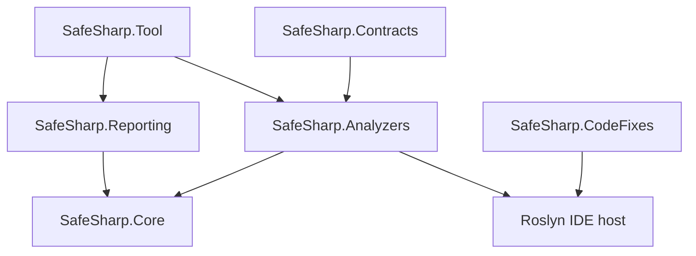

# SafeSharp

**Ownership, borrowing, disposal, and service-lifetime analysis for C# at the Roslyn analyzer stage.**

[](https://github.com/wieslawsoltes/SafeSharp/actions/workflows/ci.yml)
[](LICENSE)

SafeSharp combines a compiler-independent dataflow engine with Roslyn semantic analysis and explicit API contracts. It tracks resource identity across aliases, checks shared and exclusive loans, expires loans at their last use, follows ownership transfers, and explains violations with exact source locations and computed control-flow/state graphs.

The current implementation is **`0.4.0-preview.1`**. Its design is informed by Rust's MIR borrow checker and non-lexical lifetimes. It is an independent C# implementation, with a [pinned Rust source reference and explicit support matrix](docs/rust-design.md). It does **not** establish Rust-equivalent memory safety for arbitrary C#: reflection, unmodeled calls, native code, and unrestricted heap aliasing remain outside the proof boundary.

## What is implemented

| Area | Analysis |
| --- | --- |
| Resource ownership | Use after disposal, repeated disposal, leaks, lost ownership on overwrite, owned results, consuming parameters, explicit moves, and aliases invalidated by moves. |
| Borrowing | Shared/exclusive loans, two-phase implicit receiver/argument borrows, stable evaluated call values, reborrows, mutation/disposal conflicts, projected overlap, and indexed backward control-flow loan liveness with hybrid bitsets and cached block effects. |
| Borrowed escapes | Bounded CFG may-origin analysis follows aliases, ref slots, allocation containers and captured cells into persistent storage, returned containers/delegates, and explicit no-escape contract violations. |
| Lifetime contracts | `[Lifetime]`, `[Outlives]`, `[TypeLifetime]` and `[TypeOutlives]`; named regions, nested callable binders, placeholder visibility and leak checks, declared generic variance, explicit/implied type bounds, direct-call obligations, inherited promises, returned-value provenance, and shortest relation proofs. |
| Control flow | Forward fixed points over branches and loops; nullable guards; explicit throw/rethrow; typed catches and filters; implicit fault markers; finally and using cleanup continuations; return validation after cleanup. |
| Async and views | Nested Task/ValueTask results, cached payload/loan identity, single-consumption ValueTask capabilities, modeled `WhenAll`/`WhenAny`/`Unwrap`/`WaitAsync`, contract-driven custom awaiters, disposal completion obligations, suspension restrictions, pool leases, and modeled `Memory`/`Span` views. |
| Source summaries and references | Bounded exception/filter/finally routing, ref-return storage identities, canonical array/ref cells, stable evaluated argument locations, strong/weak writes, exceptional writable-ref invalidation, simultaneous normal-exit ref/out postconditions, and separate nested async payload provenance. |
| API and aggregates | Factories and owned `out` results; inherited contracts; every-normal-exit aggregate cleanup with helper summaries, separate sync/async entrypoints, copyable owners, and `[MustUse]`. |
| Services and callbacks | Scoped resource owners, scope escape/invalidation, singleton-to-scoped dependency paths, constructor/factory registration analysis, escaping callbacks, and declared thread-affinity checks. |
| Concurrency | Explicit `[Send]` / `[Sync]` composition, generic requirements, callback boundaries and thread affinity; `[GuardedBy]` / `[RequiresLock]` access contracts checked against modeled Monitor, `System.Threading.Lock`, `ReaderWriterLockSlim`, and `SemaphoreSlim` capabilities. |
| Evidence | Definite/possible certainty, instruction states, ref-storage and ValueTask capability tables, cached async aggregates, CFGs, assumed/required region graphs, universe visibility proofs, guard evidence, and dependency witnesses. |
| Integration | Compiler/IDE diagnostics, EditorConfig severity and budgets, six NuGet packages, an optional safe code fix, a standalone .NET tool, and CI/release workflows. |

There are **43 diagnostic rules**. Their exact triggers, defaults, examples, remedies, and limitations are in the [diagnostic reference](docs/diagnostics.md). The engine reports budget exhaustion explicitly; an incomplete result does not count as a successful analysis.

## Engine performance

The core interns place and region identities, uses sparse/dense immutable liveness sets, summarizes block effects, and retains compact predecessor forests for lazy shortest region proofs. The new domains use indexed identities, bounded worklists, cached summaries and singleton fast paths. The [reproducible benchmark harness and raw 0.4 results](docs/performance-0.4.md) compare liveness against the independent pre-optimization HashSet algorithm and measure the other domains separately. The current comparison extends both solvers' transfer rules for new reference instructions; historical measurements retain their original semantics.

The recorded **0.4 run** verified all **19 scenarios**, with five warmups and fifteen measured samples on .NET 10.0.13/Linux. Four liveness workloads improved by **2.21–69.50×** against the frozen baseline; sparse temporaries took **19.5% longer** while allocating **46.1% less**. Reference storage, ValueTask composition and higher-ranked binders have current-only time/allocation measurements, with no historical speedup claim.

A subsequent [inline-word optimization and measurement](docs/performance-0.4.md#inline-word-follow-up) reduced sparse-temporary allocation from **1,626,368 to 1,314,896 bytes** per solve, a further **19.2%** reduction. The raw follow-up record includes all five liveness shapes. Its elapsed times were collected under substantial shared-host contention and do not establish an upgrade speedup; later reference-address transfer semantics are also outside that measurement checkpoint.

These are engine workloads, not whole-build measurements. Parsing, graph construction, snapshots and report output have separate costs. The [historical 0.3 measurements and algorithm discussion](docs/performance.md) remain available; differences between those runs do not establish a 0.3-to-0.4 speedup or regression.

## Add the analyzer

Build the packages locally or download the package artifact from [CI](https://github.com/wieslawsoltes/SafeSharp/actions/workflows/ci.yml). Packages are prepared for NuGet publishing; committing the repository does not publish them to nuget.org.

```xml
<ItemGroup>
  <PackageReference Include="SafeSharp.Analyzers" Version="0.4.0-preview.1" PrivateAssets="all" />
  <PackageReference Include="SafeSharp.Contracts" Version="0.4.0-preview.1" />
  <PackageReference Include="SafeSharp.CodeFixes" Version="0.4.0-preview.1" PrivateAssets="all" />
</ItemGroup>
```

`SafeSharp.Contracts` is optional for ordinary disposable checks, and enables explicit ownership/borrowing conventions. `SafeSharp.CodeFixes` is optional. Analyzer assemblies target .NET Standard 2.0 and require a compiler host with Roslyn 4.14 or newer. The tested development SDK and command-line tool use .NET 10.

Promote selected diagnostics to build errors in `.editorconfig`:

```ini
[*.cs]
dotnet_diagnostic.SS0001.severity = error
dotnet_diagnostic.SS0004.severity = error
dotnet_diagnostic.SS0006.severity = error
safesharp_max_iterations = 10000
safesharp_max_tracked_resources = 2048
```

See [installation and integration](docs/integration.md) for package layout, all configuration options, consumer validation, and NuGet trusted publishing setup.

## Ownership and borrowing in code

C# assignments remain aliases. Explicit transfers and API contracts express intent for analysis:

```csharp
using System.IO;
using SafeSharp;

static void Release([Consumes] MemoryStream stream) => stream.Dispose();

static void InvalidMove()
{
    var original = new MemoryStream();
    var alias = original;
    var next = Ownership.Move(original);
    Release(next);
    alias.WriteByte(1); // SS0004: the prior alias is used after ownership moved.
}
```

Loans are checked until their last relevant use, rather than until the end of the local's lexical scope:

```csharp
using var owner = new DocumentBuffer();
var view = Ownership.Borrow(owner);
Console.WriteLine(view.Length); // Last use of the shared loan.
owner.Append("Allowed after the loan ends");

var exclusive = Ownership.BorrowMut(owner);
exclusive.Append("Access through the exclusive loan");
Console.WriteLine(exclusive.Length);
```

The complete, compiling [`DocumentBuffer` example](samples/SafeSharp.Sample/Program.cs) marks its mutating operation with `[Mutates]` and its disposable field with `[Owned]`. Further [unsafe examples](samples/UnsafeExamples.cs.txt) illustrate reports. `Ownership.Move`, `Borrow`, and `BorrowMut` return their arguments unchanged: they add compile-time meaning and do not enforce access restrictions at runtime.

Contracts include `[Owned]`, `[Consumes]`, `[Borrowed]`, `[BorrowedMut]`, `[ReturnsOwned]`, `[ReturnsBorrowed]`, `[Mutates]`, `[DoesNotEscape]`, `[MustUse]`, `[NoSuspend]`, `[Lifetime]`, `[Outlives]`, `[TypeLifetime]`, `[TypeOutlives]`, `[Send]`, `[Sync]`, `[TransfersToThread]`, `[SharesAcrossThreads]`, `[ThreadAffine]`, `[ThreadSafe]`, `[GuardedBy]`, `[RequiresLock]`, and `[ServiceLifetime]`. See [contracts and semantic analysis](docs/contracts-and-semantics.md), [type lifetime contracts](docs/type-lifetimes.md), and [synchronization analysis](docs/synchronization-analysis.md) for supported positions and semantics.

## Inspect the analysis

The compiler analyzer performs no report-file I/O. The separate tool uses the same engine and Roslyn analyzers, loading real projects/solutions through MSBuild or standalone C# files with explicit references.

```sh
dotnet tool install SafeSharp.Tool --tool-path .tools \
  --version 0.4.0-preview.1 --add-source artifacts/packages

.tools/safesharp --project samples/SafeSharp.Sample/SafeSharp.Sample.csproj \
  --format html --output artifacts/ownership.html

.tools/safesharp --solution SafeSharp.sln \
  --format sarif --output artifacts/ownership.sarif
```

| Format | Output |
| --- | --- |
| HTML | Self-contained interactive CFG/state inspector with SVG graphs, method selection, issue filtering, lifetime universes and requirements, ref storage, ValueTask capabilities, cached async payloads, and source evidence. |
| JSON | Machine-readable diagnostics, resource/loan/reference/capability facts, graph edges, and instruction snapshots. |
| SARIF 2.1.0 | Source locations, rule metadata, related locations, and abstract provenance for analysis integrations. |
| DOT | Control-flow, declared/required region, and service-dependency witness diagrams for Graphviz. |
| Mermaid | The same graph relationships as portable text for Markdown documentation and review. |

Report edges and states come from the computed analysis. Evidence is abstract provenance, not a fabricated executable path. Project-mode reports honor analyzer configuration. CLI exit codes distinguish findings (`1`), errors/incomplete analysis (`2`), and cancellation (`130`); `--fail-on none` does not hide incomplete analysis. See the [reporting guide](docs/reporting.md).

The [async and delegate example report](docs/examples/async-delegates.html) shows universal lifetime requirements, abandoned factory results, and cached payload identity across repeated awaits. Its [source fixture](samples/AsyncDelegateExamples.cs.txt) includes both accepted and rejected cases.

The [0.4 boundary report](docs/examples/boundaries.html), generated from [BoundaryExamples.cs.txt](samples/BoundaryExamples.cs.txt), adds a nested placeholder leak, stable `WhenAll` payloads, single-consumption `ValueTask` capabilities, reference-storage aliases, and required/held guard evidence. It includes accepted alternatives alongside each violated boundary.

Download and open the generated [example HTML report](docs/examples/ownership.html) for computed method graphs, ownership and lifetime diagnostics, and per-instruction state inspection from the included unsafe examples. The reporting guide includes the regeneration command.

## Architecture and packages



| Project / package | Responsibility |
| --- | --- |
| `SafeSharp.Contracts` | Small runtime annotation/marker API with no Roslyn dependency. |
| `SafeSharp.Core` | Immutable intermediate representation, liveness, ownership abstract interpretation, results and evidence; reusable without Roslyn. |
| `SafeSharp.Analyzers` | Semantic contracts and service analysis, Roslyn CFG lowering, compiler diagnostics and configuration. Ships Core adjacent to the analyzer. |
| `SafeSharp.Reporting` | Independent report-writer interface and five format implementations. |
| `SafeSharp.Tool` | .NET tool entry point, MSBuild/source loading, configured analyzer execution and atomic report output. |
| `SafeSharp.CodeFixes` | Conservative `[MustUse]` acknowledgement fix with Fix All; does not invent disposal/ownership intent. |

Compilation-scoped summaries avoid global symbol retention. Analyzer execution is concurrent and cancellation-aware; the core engine is reusable across independent analyses. Dataflow, syntax lowering, semantic conventions, diagnostic presentation, and file output have separate responsibilities. The [architecture document](docs/architecture.md) describes state domains, effects, exception normalization, budgets, and extension points.

## Build, test, and package

Install a .NET 10 SDK; `global.json` rolls forward within that SDK generation.

```sh
dotnet restore SafeSharp.sln
dotnet build SafeSharp.sln -c Release --no-restore
dotnet test tests/SafeSharp.Tests/SafeSharp.Tests.csproj -c Release --no-build
python tests/cli/verify.py --tool src/SafeSharp.Tool/bin/Release/net10.0/SafeSharp.Tool.dll
dotnet run --project benchmarks/SafeSharp.Benchmarks -c Release -- all --iterations 1 --warmup 0 --json artifacts/benchmarks/smoke.json
dotnet pack SafeSharp.sln -c Release --no-build -o artifacts/packages
python eng/verify-packages.py artifacts/packages
python eng/smoke-consumer.py artifacts/packages --version 0.4.0-preview.1
```

The combined 0.4 regression run passes **2,490 tests on each of Linux, Windows, and macOS**, with no failures or skips and zero build warnings/errors. These tests exercise real Roslyn compilations and reject invalid fixtures or analyzer crashes. Coverage includes core lattice/liveness behavior, positive and negative analyzer cases, direct-call lifetime obligations and mutation invalidation, nested binders, exception-aware summaries, canonical array/ref storage and captured-address liveness, async composition, semaphore/lock contracts, service graphs, code-fix results, binary constructor compatibility and deterministic/escaped reports. The separate CLI gate checks all five formats, project/solution loading, exits, severities and completeness. Package tests restore a clean external consumer, verify accepted and rejected programs, and install and invoke the packaged tool. An independent Roslyn 4.14 host checks the packaged higher-ranked Core solver, direct-call/nested lifetime diagnostics, ValueTask consumption, Monitor/semaphore guards, array-ref disposal and the live code fix. All three operating systems pass the complete build/test/benchmark/package/consumer pipeline.

All six packages include README/license/repository metadata and portable symbol packages. Versions, Source Link, reproducibility, compiler dependency isolation, and trusted publishing are configured centrally. The release workflow validates packages and a real consumer before requesting a short-lived NuGet publishing credential.

## Analysis boundaries and future work

SafeSharp is a preview analysis system. The implemented rules require the documented effects and contracts to describe actual runtime behavior. A recognized disposal invocation discharges the modeled obligation even if the disposer throws; it does not prove successful physical cleanup. Unhandled implicit faults are a labeled boundary with a separate exception-safety advisory. Aggregate cleanup is checked on every modeled normal exit, with bounded source-helper summaries. This excludes a claim about successful physical cleanup after arbitrary exceptional termination.

Nested higher-ranked universes, placeholder leak checks, explicit type lifetime paths, bounded variance/type-bound checks, two-phase borrowing and explicit concurrency conventions are implemented. Type lifetime contracts apply to corresponding annotated paths in direct invocations, delegate conversions and inherited-signature comparisons; the analyzer does not infer arbitrary nested object contents or reproduce Rust's full trait/type system. Async composition covers documented framework operations and represented inputs. Synchronization checks establish sequential guard capabilities for declared accesses; they do not establish general race freedom, deadlock freedom or CLR memory ordering.

Full type/trait lifetime inference, `Pin`, unsafe pointer provenance, symbolic heap/index reasoning and whole-program verification remain outside this model. C# definite-assignment and ref-safety rules remain the C# compiler's responsibility. The [implementation matrix](docs/implementation-status.md#deliberate-precision-boundaries) and [Rust comparison](docs/rust-design.md#semantic-differences-and-unsupported-rust-guarantees) record the remaining limits alongside implemented capabilities and pinned source links.

Contributions should define the effect being added, include both valid and invalid regression cases, and update the diagnostic/support documentation. Broader guarantees should follow demonstrated analysis coverage.

## Documentation

- [Changes in the 0.4 preview](CHANGELOG.md)
- [Implementation status and remaining boundaries](docs/implementation-status.md)
- [Diagnostic reference](docs/diagnostics.md)
- [Two-phase borrowing and async completion protocols](docs/advanced-engine.md)
- [Named lifetime regions and returned borrows](docs/lifetime-regions.md)
- [Higher-ranked universes and placeholder leak checking](docs/higher-ranked-regions.md)
- [Nested type lifetime contracts and variance](docs/type-lifetimes.md)
- [Direct invocation lifetime obligations and evidence](docs/direct-call-lifetimes.md)
- [ValueTask single-consumption capabilities](docs/value-task-consumption.md)
- [Nested asynchronous ownership and custom awaiters](docs/nested-async-ownership.md)
- [Framework task composition and aggregate identities](docs/async-task-composition.md)
- [Exception-aware source summaries](docs/source-summary-analysis.md)
- [Reference storage and normal-exit postconditions](docs/reference-storage-analysis.md)
- [Canonical aggregate/reference storage and weak updates](docs/aggregate-reference-storage.md)
- [Guarded access and lock capabilities](docs/synchronization-analysis.md)
- [SemaphoreSlim permit capabilities and async guards](docs/semaphore-capabilities.md)
- [Borrowed aliases, containers, and escape analysis](docs/borrowed-escape.md)
- [Aggregate cleanup and concurrency contracts](docs/aggregate-concurrency.md)
- [Contracts, aggregates, callbacks, and services](docs/contracts-and-semantics.md)
- [Engine and Roslyn architecture](docs/architecture.md)
- [Rust source references and feature comparison](docs/rust-design.md)
- [Reports and command-line analysis](docs/reporting.md)
- [NuGet, configuration, CI, and release setup](docs/integration.md)
- [Code fixes and their safety conditions](docs/code-fixes.md)

## License

[MIT](LICENSE). Rust sources and documentation are cited as design references; no Rust compiler implementation code is copied into this repository.
