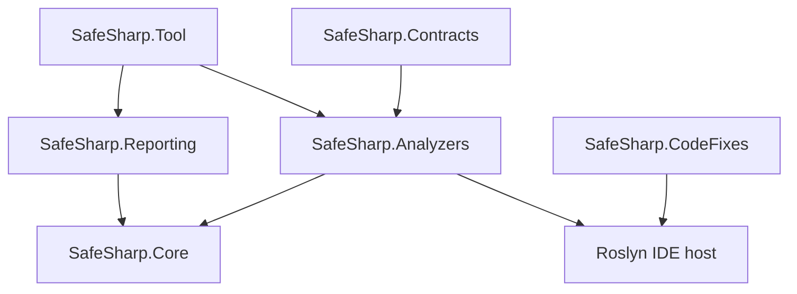

# SafeSharp

**Ownership, borrowing, disposal, and service-lifetime analysis for C# at the Roslyn analyzer stage.**

[](https://github.com/wieslawsoltes/SafeSharp/actions/workflows/ci.yml)
[](LICENSE)

SafeSharp combines a compiler-independent dataflow engine with Roslyn semantic analysis and explicit API contracts. It tracks resource identity across aliases, checks shared and exclusive loans, expires loans at their last use, follows ownership transfers, and explains violations with exact source locations and computed control-flow/state graphs.

The initial implementation is **`0.1.0-preview.1`**. Its design is informed by Rust's MIR borrow checker and non-lexical lifetimes. It is an independent C# implementation, with a [pinned Rust source reference and explicit support matrix](docs/rust-design.md). It does **not** establish Rust-equivalent memory safety for arbitrary C#: reflection, unmodeled calls, native code, and unrestricted heap aliasing remain outside the proof boundary.

## What is implemented

| Area | Analysis |
| --- | --- |
| Resource ownership | Use after disposal, repeated disposal, leaks, lost ownership on overwrite, owned results, consuming parameters, explicit moves, and aliases invalidated by moves. |
| Borrowing | Shared/exclusive loans, mutation and disposal conflicts, reborrows, borrowed escapes, projected-field overlap, conservative array overlap, and loan expiry based on backward control-flow liveness. |
| Control flow | Forward fixed points over branches and loops; nullable guards; explicit throw/rethrow; typed catches and filters; implicit fault markers; finally and using cleanup continuations; return validation after cleanup. |
| Async and views | Awaited disposal, `await using`, ignored asynchronous disposal, live borrows across suspension, `[NoSuspend]`, pooled-resource leases, and modeled `Memory`/`Span` views. |
| API and aggregates | Owned/borrowed contracts, interface and override contract inheritance, incompatible parameter contracts, owned disposable fields, missing cleanup structure, copyable owned structs, and `[MustUse]`. |
| Services and callbacks | Scoped resource owners, scope escape/invalidation, singleton-to-scoped dependency paths, constructor/factory registration analysis, escaping callbacks, and declared thread-affinity checks. |
| Evidence | Definite/possible certainty, source-related acquisition/loan/move/disposal evidence, instruction states, live places, CFGs, and dependency witnesses. |
| Integration | Compiler/IDE diagnostics, EditorConfig severity and budgets, six NuGet packages, an optional safe code fix, a standalone .NET tool, and CI/release workflows. |

There are **31 diagnostic rules**. Their exact triggers, defaults, examples, remedies, and limitations are in the [diagnostic reference](docs/diagnostics.md). The engine reports budget exhaustion explicitly; an incomplete result does not count as a successful analysis.

## Add the analyzer

Build the packages locally or download the package artifact from [CI](https://github.com/wieslawsoltes/SafeSharp/actions/workflows/ci.yml). Packages are prepared for NuGet publishing; committing the repository does not publish them to nuget.org.

```xml
<ItemGroup>
  <PackageReference Include="SafeSharp.Analyzers" Version="0.1.0-preview.1" PrivateAssets="all" />
  <PackageReference Include="SafeSharp.Contracts" Version="0.1.0-preview.1" />
  <PackageReference Include="SafeSharp.CodeFixes" Version="0.1.0-preview.1" PrivateAssets="all" />
</ItemGroup>
```

`SafeSharp.Contracts` is optional for ordinary disposable checks, and enables explicit ownership/borrowing conventions. `SafeSharp.CodeFixes` is optional. Analyzer assemblies target .NET Standard 2.0 and require a compiler host with Roslyn 4.14 or newer. The tested development SDK and command-line tool use .NET 10.

Promote selected diagnostics to build errors in `.editorconfig`:

```ini
[*.cs]
dotnet_diagnostic.SS0001.severity = error
dotnet_diagnostic.SS0004.severity = error
dotnet_diagnostic.SS0006.severity = error
safesharp_max_iterations = 10000
safesharp_max_tracked_resources = 2048
```

See [installation and integration](docs/integration.md) for package layout, all configuration options, consumer validation, and NuGet trusted publishing setup.

## Ownership and borrowing in code

C# assignments remain aliases. Explicit transfers and API contracts express intent for analysis:

```csharp
using System.IO;
using SafeSharp;

static void Release([Consumes] MemoryStream stream) => stream.Dispose();

static void InvalidMove()
{
    var original = new MemoryStream();
    var alias = original;
    var next = Ownership.Move(original);
    Release(next);
    alias.WriteByte(1); // SS0004: the prior alias is used after ownership moved.
}
```

Loans are checked until their last relevant use, rather than until the end of the local's lexical scope:

```csharp
using var owner = new DocumentBuffer();
var view = Ownership.Borrow(owner);
Console.WriteLine(view.Length); // Last use of the shared loan.
owner.Append("Allowed after the loan ends");

var exclusive = Ownership.BorrowMut(owner);
exclusive.Append("Access through the exclusive loan");
Console.WriteLine(exclusive.Length);
```

The complete, compiling [`DocumentBuffer` example](samples/SafeSharp.Sample/Program.cs) marks its mutating operation with `[Mutates]` and its disposable field with `[Owned]`. Further [unsafe examples](samples/UnsafeExamples.cs.txt) illustrate reports. `Ownership.Move`, `Borrow`, and `BorrowMut` return their arguments unchanged: they add compile-time meaning and do not enforce access restrictions at runtime.

Contracts include `[Owned]`, `[Consumes]`, `[Borrowed]`, `[BorrowedMut]`, `[ReturnsOwned]`, `[ReturnsBorrowed]`, `[Mutates]`, `[DoesNotEscape]`, `[MustUse]`, `[NoSuspend]`, `[ThreadAffine]`, `[ThreadSafe]`, and `[ServiceLifetime]`. See [contracts and semantic analysis](docs/contracts-and-semantics.md) for supported positions and semantics.

## Inspect the analysis

The compiler analyzer performs no report-file I/O. The separate tool uses the same engine and Roslyn analyzers, loading real projects/solutions through MSBuild or standalone C# files with explicit references.

```sh
dotnet tool install SafeSharp.Tool --tool-path .tools \
  --version 0.1.0-preview.1 --add-source artifacts/packages

.tools/safesharp --project samples/SafeSharp.Sample/SafeSharp.Sample.csproj \
  --format html --output artifacts/ownership.html

.tools/safesharp --solution SafeSharp.sln \
  --format sarif --output artifacts/ownership.sarif
```

| Format | Output |
| --- | --- |
| HTML | Self-contained interactive CFG/state inspector with SVG graphs, method selection, issue filtering, liveness, and source evidence. |
| JSON | Machine-readable diagnostics, resource/loan facts, graph edges, and instruction snapshots. |
| SARIF 2.1.0 | Source locations, rule metadata, related locations, and abstract provenance for analysis integrations. |
| DOT | Control-flow and service-dependency witness diagrams for Graphviz. |
| Mermaid | Portable graph text for Markdown documentation and review. |

Report edges and states come from the computed analysis. Evidence is abstract provenance, not a fabricated executable path. Project-mode reports honor analyzer configuration. CLI exit codes distinguish findings (`1`), errors/incomplete analysis (`2`), and cancellation (`130`); `--fail-on none` does not hide incomplete analysis. See the [reporting guide](docs/reporting.md).

## Architecture and packages



| Project / package | Responsibility |
| --- | --- |
| `SafeSharp.Contracts` | Small runtime annotation/marker API with no Roslyn dependency. |
| `SafeSharp.Core` | Immutable intermediate representation, liveness, ownership abstract interpretation, results and evidence; reusable without Roslyn. |
| `SafeSharp.Analyzers` | Semantic contracts and service analysis, Roslyn CFG lowering, compiler diagnostics and configuration. Ships Core adjacent to the analyzer. |
| `SafeSharp.Reporting` | Independent report-writer interface and five format implementations. |
| `SafeSharp.Tool` | .NET tool entry point, MSBuild/source loading, configured analyzer execution and atomic report output. |
| `SafeSharp.CodeFixes` | Conservative `[MustUse]` acknowledgement fix with Fix All; does not invent disposal/ownership intent. |

Compilation-scoped summaries avoid global symbol retention. Analyzer execution is concurrent and cancellation-aware; the core engine is reusable across independent analyses. Dataflow, syntax lowering, semantic conventions, diagnostic presentation, and file output have separate responsibilities. The [architecture document](docs/architecture.md) describes state domains, effects, exception normalization, budgets, and extension points.

## Build, test, and package

Install a .NET 10 SDK; `global.json` rolls forward within that SDK generation.

```sh
dotnet restore SafeSharp.sln
dotnet build SafeSharp.sln -c Release --no-restore
dotnet test tests/SafeSharp.Tests/SafeSharp.Tests.csproj -c Release --no-build
python tests/cli/verify.py --tool src/SafeSharp.Tool/bin/Release/net10.0/SafeSharp.Tool.dll
dotnet pack SafeSharp.sln -c Release --no-build -o artifacts/packages
python eng/verify-packages.py artifacts/packages
python eng/smoke-consumer.py artifacts/packages --version 0.1.0-preview.1
```

The regression suites exercise real Roslyn compilations and reject invalid test fixtures or analyzer crashes. Coverage includes core lattice/liveness behavior, positive and negative analyzer cases, exceptional control flow, contracts, service graphs, code-fix results, deterministic/escaped reports, and configured CLI behavior. Package tests restore a clean external consumer, verify both a safe build and a failing unsafe build, and install and invoke the packaged tool. CI runs the build/test/package pipeline on Linux, Windows, and macOS.

All six packages include README/license/repository metadata and portable symbol packages. Versions, Source Link, reproducibility, compiler dependency isolation, and trusted publishing are configured centrally. The release workflow validates packages and a real consumer before requesting a short-lived NuGet publishing credential.

## Analysis boundaries and future work

SafeSharp is a preview analysis system. The implemented rules require the documented effects and contracts to describe actual runtime behavior. A recognized disposal invocation discharges the modeled obligation even if the disposer throws; it does not prove successful physical cleanup. Unhandled implicit faults are a labeled boundary with a separate exception-safety advisory. Aggregate field cleanup checks are structural rather than complete interprocedural all-path proofs.

Full Rust lifetime quantification, higher-ranked regions, generic trait solving, `Send`/`Sync`, `Pin`, two-phase borrows, unsafe pointer provenance, symbolic heap/index reasoning, and whole-program verification are not implemented. C# definite-assignment and ref-safety rules remain the C# compiler's responsibility. The [Rust comparison](docs/rust-design.md#semantic-differences-and-unsupported-rust-guarantees) records these limits alongside implemented capabilities and pinned source links.

Contributions should define the effect being added, include both valid and invalid regression cases, and update the diagnostic/support documentation. Broader guarantees should follow demonstrated analysis coverage.

## Documentation

- [Diagnostic reference](docs/diagnostics.md)
- [Contracts, aggregates, callbacks, and services](docs/contracts-and-semantics.md)
- [Engine and Roslyn architecture](docs/architecture.md)
- [Rust source references and feature comparison](docs/rust-design.md)
- [Reports and command-line analysis](docs/reporting.md)
- [NuGet, configuration, CI, and release setup](docs/integration.md)
- [Code fixes and their safety conditions](docs/code-fixes.md)

## License

[MIT](LICENSE). Rust sources and documentation are cited as design references; no Rust compiler implementation code is copied into this repository.
