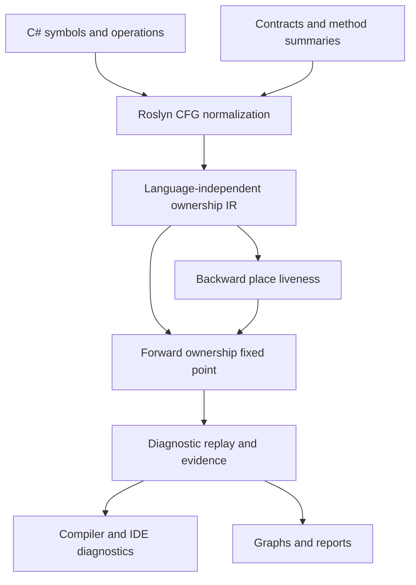

# Architecture and analysis contracts

## Boundaries

SafeSharp is an independent C# implementation inspired by Rust's borrow checker design. It does not embed Rust compiler code, translate C# into Rust, replace the CLR, or claim a proof of memory safety for arbitrary C#. Explicit ownership contracts and recognized resource APIs give the analyzer a model it can check. Ordinary unannotated C# reference assignment retains its runtime aliasing semantics.

`SafeSharp.Core` owns IR validation, abstract state, place overlap, loan liveness, transfer semantics, the fixed-point schedule, and results. It has no Roslyn dependency. `SafeSharp.Analyzers` owns symbol classification, contract summaries, CFG normalization, diagnostic descriptors, and compiler registration. Its services live for one compilation; there is no mutable global compilation cache. `SafeSharp.Reporting` only depends on Core and formats immutable results. `SafeSharp.Tool` owns file I/O, workspace loading, compiler-error handling, output selection and exit status. `SafeSharp.Contracts` contains the small public annotation vocabulary. `SafeSharp.CodeFixes` is an optional independent IDE package.

## Abstract domain

A place is a stable parameter/local/capture identity followed by zero or more projections. A resource is identified by its allocation site or external input. Places contain sets of abstract reference alternatives: resource identity, availability, loan origin, field projection, and moved subpaths. Resources carry ownership kind, lifecycle flags, acquisition evidence, and optional owning-scope identities. Loans carry shared/exclusive kind, reserved/active phase alternatives, holder, origin, activation sites, projection, reborrow ancestry, and suspension policy. Async disposal completions have a separate resource kind, pending/completed status, and provenance identifying the resource whose disposal they observe.

Reference storage is a separate immutable domain. A reference binding names flattened target locations rather than an evaluated value, so rebinding one ref local does not redirect a previously captured reference. Reads resolve through the target set; a single target permits a strong update and alternatives require weak updates. Represented array-element references bind to canonical aggregate cells, sharing resource and ValueTask identities with ordinary indexed reads and writes. Wildcard selectors retain the captured array identity and expand against current cells, including cells materialized after the address was captured. ValueTask capabilities form another finite domain, independent of whether the eventual result is disposable. Copies share capability identity and available/consumed/transferred alternatives. A move invalidates prior holders; AsTask/Preserve consume the original capability and produce reusable modeled handles. Both domains participate in joins and snapshots without encoding storage or consumption in resource names.

Represented arrays use canonical aggregate resource identities with indexed resource and ValueTask element alternatives. Aliases share that cache. Unmodeled calls conservatively invalidate represented array contents before their possible throw edge, while independent value snapshots and previously captured composition inputs retain identity. Loop allocation sites can summarize several concrete aggregates and then require weak updates. Async composition resources retain their kind and dependencies; successful receives materialize or reuse intermediate carriers, aggregate outputs or terminal resources. Iterative visited-identity traversal prevents cycles in composed carrier/aggregate graphs. These facts describe supported framework operations and represented inputs, not arbitrary collection or concurrent mutation behavior.

At a control-flow merge the engine retains alternatives. It does not collapse `alive OR disposed` into either `alive` or `disposed`. A finding is **definite** only when all represented alternatives violate the rule; otherwise it is **possible**. Absent allocations and place/resource correlations matter: two allocations in mutually exclusive branches must not look like two simultaneously leaked resources.

Moves invalidate existing aliases to the transferred value. A moved-to place obtains the current ownership handle; stale aliases do not regain access. Ordinary assignment preserves alias identity, so disposal through any alias affects the others. Reassignment starts a new local ownership value. Structural projections support overlapping aggregate/field access and partial moves; unknown array indices conservatively overlap. Heap aliases introduced by unmodeled APIs, reflection, native code or pointer arithmetic remain outside the proof boundary.

Allocation-site abstraction makes loops finite. It does not count concrete allocation instances. Reusing an allocation site must not reactivate a stale alias from an earlier iteration. The model and tests distinguish branch-local allocations, loop-carried aliases, repeated disposal, and owner overwrites.

## Solvers and non-lexical lifetimes

The backwards solver computes live places at each instruction. The forward worklist joins predecessor states, applies ownership effects, and expires loans according to those live sets. A loan can end before its variable's lexical block ends. Multiple shared borrows are compatible; an active exclusive borrow conflicts with overlapping loans. A reservation permits reads and shared borrowing during argument evaluation, then checks conflicts again on activation. Explicit exclusive loans start active. Every argument value remains live through the call, including explicit loans passed to unannotated parameters. A write through a reference uses its captured address; it does not kill that reference binding's liveness. This keeps an earlier aggregate allocation generation represented even when the next use of its ref is an overwrite. Rebinding or releasing the reference ends the previous binding. Reborrows retain the necessary parent ancestry so the parent cannot be used while a child loan is active.

Canonical storage identity does not add a deep-container permission domain. The array-element model does not derive a child loan from a loan of the containing array or propagate every later parent-loan restriction through a captured element ref. The [aggregate reference guide](aggregate-reference-storage.md) separates the implemented storage coherence from this remaining borrowing boundary.

Diagnostics are replayed after convergence, preventing warnings based solely on transient solver states. Related locations identify concrete source origins and conflicting effects. Evidence is an abstract explanation, not a fabricated single feasible counterexample path: a may-analysis join may combine facts from different execution paths. JSON/SARIF/HTML preserve that distinction.

The engine is reentrant, uses finite resource/place/loan/capability identities, checks cancellation, and imposes configurable resource and iteration limits. Reaching a limit emits `SS0015`; reference storage additionally bounds target count, binding count and location length. Service dependency exploration has its own `SS0029`. Lifetime solving/provenance uses `SS0043`, and aggregate/concurrency composition, synchronization and borrowed-escape provenance use `SS0046`. All appear as incomplete CLI analysis even if their visible diagnostic severity is suppressed. Snapshot capture is off inside ordinary compiler analysis, so detailed per-instruction snapshots are only materialized when a reporting caller requests them.

## C# control flow and exceptions

Roslyn represents `using` and `try/finally` with implicit cleanup continuations. Normalization makes these edges explicit and clones cleanup contexts for distinct return destinations. A return expression is evaluated before cleanup, but the returned ownership value is validated after cleanup. This catches returning a resource that a `using` declaration disposes while leaving the method.

Null tests are edge assumptions. Impossible null branches after known allocations must not create false leaks through skipped implicit disposal. The exception model separates explicit throw/catch/finally control flow from implicit exception boundaries; the implementation and tests cover the supported normalized cases. Ordinary unhandled exception safety is also audited by `SS0030`, which recommends structured cleanup where a later manual release can be bypassed.

An exception thrown by arbitrary native code or a partially executing disposal implementation cannot be reconstructed completely from an analyzer's method-local model. Arbitrary library calls also need summaries to expose retained aliases or ownership transfers. See the precise [Rust support matrix](rust-design.md) and [diagnostic limitations](diagnostics.md).

The caller's disposal obligation is discharged when the recognized cleanup operation is invoked, including when its implementation subsequently throws. The analyzer verifies the caller's release protocol; successful physical cleanup remains the implementation's responsibility. Consequently, a correct `using` inside a catchable region does not become a leak merely because `Dispose` itself may throw. Reusing the resource after that attempted cleanup is still diagnosed.

## Interprocedural and service analysis

Boundary summaries recognize explicit consuming, borrowing, mutation and return contracts. Source inference uses a bounded may-origin CFG analysis for fresh returned allocations, source aliases, branches, loops, wrapper calls and owned out results. Unknown origins survive joins. Separate indexed value slots and reference targets preserve ref aliases, conditional refs and ref reassignment. Calls capture storage targets in C# evaluation order, evaluate input values at call entry and apply modeled normal-exit outputs together. Source ref-return targets are parameter ordinals mapped to those captured locations, with explicit external/unknown alternatives. A by-value return snapshots its value before cleanup; a ref return captures its location and reads the surviving value at normal exit.

`MethodOriginAnalysis` and `LifetimeReturnFlow` share `SourceControlFlowRouter`. Its bounded continuation worklist preserves first-pass filter search, rejecting/throwing filter effects, inner-to-outer unwind cleanup, selected handlers and cleanup before a normal return completes. An unhandled exception produces no normal-exit postcondition. The ownership adapter does not replay normal-call write summaries on exceptional edges. It carries evaluated writable ref/out addresses into the exceptional continuation and applies `InvalidateAggregateReference` to their canonical cells before filter selection and unwind cleanup. This preserves possible old/replacement outcomes without inventing new owners or reconstructing an arbitrary callee's exceptional write history; readonly input refs do not acquire a writable-cell effect. Source summaries distinguish carrier identity from terminal result provenance beneath up to 16 Task/ValueTask layers. Unknown native/virtual/recursive effects and exhausted source inference remain opaque rather than inventing freshness. See [source summary analysis](source-summary-analysis.md), [reference storage](reference-storage-analysis.md), and [canonical aggregate refs](aggregate-reference-storage.md). Direct parameter disposal effects remain deliberately limited. Known BCL factories, pools, memory-owner views and dependency-injection resolution methods supply additional summaries.

An implementation that omits parameter annotations inherits the interface or overridden declaration's contracts. Parameter relationships are mapped by ordinal, so renaming a parameter does not disconnect an inherited returned borrow. Incompatible explicit parameter modes produce `SS0034`. Getter summaries consult associated base/interface property annotations. Expression-bodied properties and indexers participate in direct fresh-result inference and receive the same report graphs as ordinary methods.

Cleanup recognition resolves the actual `IDisposable`/`IAsyncDisposable` interface implementation and its virtual overrides; a same-name unrelated method does not release a resource. Valid disposal patterns on ref structs are also recognized. Assignments through `ref`/`out` parameters store into caller-visible locations and transfer modeled ownership just as a longer-lived heap store does; `out` parameters have no incoming value. Fresh owned out results can be inferred from all modeled normal exits or declared with `[Owned] out`. Supported source ref/out postconditions retain parameter/null origins and a bounded fresh-output case; the caller applies them only after a successful call. Distinct fresh outputs requiring richer correlations, arbitrary external ref-slot postconditions and retained aliases of unknown calls remain opaque.

`BorrowedEscapeAnalysis` checks persistent retention of declared borrowed/no-escape parameters in a separate CFG domain. Direct origins, allocation containers, captured cells and reference targets remain distinct: evaluating a value snapshots its origin, whereas a delegate can retain mutable storage. The solver shares compilation-scoped call summaries, propagates may sets to a fixed point, and emits SS0027 from converged states. Exception handlers and nested-function captures receive a conservative value history; this intentionally does not claim the core's more detailed exception routing. The [borrowed-escape guide](borrowed-escape.md) describes return exemptions, the stricter no-escape contract, field-insensitive containers, bounds and source evidence.

The service analyzer builds a separate constructor-dependency graph from annotated lifetimes and supported registration syntax. It detects transitive singleton capture of scoped dependencies and retains the dependency path as metadata. Container-created values remain borrowed/container-owned. A local scope relationship allows the ownership engine to detect service use after scope disposal. Factories, custom containers, runtime registration mutation, keyed matching and reflection require the documented qualifications.

## Named regions and aggregate obligations

`Core.Regions` accepts an immutable region problem independently of Roslyn. The solver constructs a deterministic implication closure, equivalence components and shortest declared-edge proofs, or an explicitly incomplete result with no partial proofs. The Roslyn lifetime adapter maps parameters by ordinal, checks inherited signature promises, and analyzes returned origins without importing caller-specific objects into a global symbol cache. Return candidates are joined using `MergeAlias` before a loan is created; alternative sources are not incorrectly represented as simultaneous exclusive loans. See [lifetime regions](lifetime-regions.md).

`HigherRankedRegionProblem` adds a lexical binder tree, root universals, nested rigid placeholders, existential inference variables and one static upper bound. Indexed ancestry intervals answer visibility queries; binary lifting intersects visible scopes. The solver checks ordinary rigid relations and opaque type-outlives obligations under one cancellation/step budget. If a component reaches an unnameable placeholder, it requires a visible static upper bound and checks the resulting rigid relation against the caller's assumptions. Original paths, promotion edges and the visibility-bound witness remain separate evidence. An unconstrained inference variable can choose the static region; a new requirement on an arbitrary caller lifetime cannot silently do so. The placeholder-free path skips universe scans.

The Roslyn adapter uses TypeLifetime paths to state which corresponding generic arguments, array elements or nested callable positions participate in a contract. It composes declared Roslyn variance, reverses callable input polarity, treats writable references and arrays invariantly and opens fresh binders at callable boundaries. Outer captures require explicit `^` references. Scoped Outlives/TypeOutlives constraints and supported input/owner implied bounds feed the same solver. Inherited constructed signatures preserve actual substituted type structure rather than matching unrelated type parameters by ordinal. These mechanisms serve annotated delegate/inherited-signature comparisons and explicit direct-call requirements. They do not prove arbitrary nested object contents or reproduce a complete trait solver. See [higher-ranked regions](higher-ranked-regions.md) and [type lifetime contracts](type-lifetimes.md).

Direct invocations build a supplied signature from stable caller parameters, transparent local aliases, and caller lifetime/type-bound assumptions. Named arguments and reduced extension receivers use Roslyn's parameter mapping; nested binders are rebased to the supplied argument positions. The callee's input contracts remain proof obligations under SS0050. A nonempty invocation extent prevents absent type evidence from passing through empty inferred regions. Per-compilation immutable effect summaries record replacement, content mutation, reference exposure, opaque calls and represented alias/escape relationships once per callable. Queries distinguish the current call's preconditions from its effects, retain conservative loop/deferred possibilities, and charge the cached work against the configured budget. Unsupported type projections and mutated or unknown contents supply no proof. Solver failures preserve the same region/type witnesses used by existing reports; budget exhaustion remains SS0043. See [direct-call lifetimes](direct-call-lifetimes.md).

Aggregate cleanup has its own obligation domain and source-helper summaries. It retains a member obligation if any modeled normal path keeps it, distinguishes replacement resources, specializes boolean disposal-pattern arguments, and expands finally continuations. Every sync/async disposal entrypoint is checked separately. Its conservative exceptional routing is documented independently from the core's normalized ownership CFG; neither layer claims physical cleanup after arbitrary exceptional termination. See [aggregate and concurrency contracts](aggregate-concurrency.md).

`DisposeAsync` lowering invokes disposal, marks the potential synchronous throw, then creates the completion obligation on the successful edge. Awaiting observes that completion before propagating its asynchronous fault. The owned resource and its completion therefore have distinct states and evidence. [Advanced engine protocols](advanced-engine.md) documents the IR effects, phase and completion lattices, supported wrappers, and graph representation.

## Synchronization contracts

The concurrency analyzer has a separate sequential guard domain for GuardedBy and RequiresLock contracts. A capability is tied to the evaluated receiver/guard identity and protocol; a Monitor acquisition on an object does not satisfy a System.Threading.Lock or ReaderWriterLockSlim requirement. Access modes and acquisition/release facts propagate through supported CFG paths. Inherited preconditions are assumed while checking a method body and required at its callers. Guarded reference aliases carry the access obligation across represented uses and escapes.

SemaphoreSlim uses its own permit protocol. Exclusive guarded access requires supported constructor evidence that maxCount is the constant 1; a one-argument constructor or CurrentCount read cannot establish that bound. A WaitAsync result carries one acquisition identity through Task aliases and supported awaiter wrappers. Successful observation establishes a permit once, timeout Booleans refine the result, and reobserving the same completed Task after release cannot reacquire it. Pending acquisitions remain obligations even if their handles are lost. Semaphore permits survive suspension because they are not thread-affine; Monitor, Lock and reader/writer capabilities retain their existing suspension restrictions. The [semaphore guide](semaphore-capabilities.md) documents binary-field construction evidence, constructor/init snapshot restrictions, release balance, exceptional routes, and finite token limits.

This analysis does not add thread schedules to the ownership fixed point. It checks declared access protocols and supported lock/semaphore APIs, while Send/Sync remains an explicit structural C# convention. GuardedBy does not relax the structural Sync rules. Counting semaphores receive local permit balance checks but cannot prove exclusive access. External signaling/releases, opaque task transformations, custom synchronization, arbitrary callbacks, unmodeled aliases, deadlock freedom, atomic memory ordering and whole-program race freedom remain outside this result. [Synchronization analysis](synchronization-analysis.md) defines the precise declaration rules, API protocols, exception behavior, evidence and limits.

## Extension points

- Add another language frontend by producing `AnalysisGraph` and `FlowInstruction` values; Core remains reusable.
- Embed `OwnershipCompilationAnalysis.Analyze` in a custom Roslyn tool and request snapshots explicitly.
- Use `SafeSharpAnalyzerCatalog.Create()` to run the same complete compiler analyzer set as the CLI.
- Implement `IAnalysisReportWriter` for another deterministic export format.
- Extend contract summaries and registration recognition independently of the solver.

Each abstraction owns one task. Exporters do not reach into Roslyn, compiler callbacks do not write files, and the core domain does not depend on IDE services.

## Indexed dataflow and universal region obligations

`PlaceUniverse` interns place names and projection kill ranges. Mutable liveness worksets use dense words plus an occupied-word index; immutable snapshots choose sparse or dense storage and share unchanged boundaries. `PlaceLiveness` precomputes each block's GEN/KILL effects before convergence. Independent string-set oracle tests verify instruction boundaries and budget behavior. The comparison oracle retains the original HashSet worklist algorithm while extending its transfer rules for new IR semantics, including captured-address uses; this keeps both implementations responsible for the same instruction meaning. The [performance guide](performance.md) records measured tradeoffs and reproduction commands.

`RegionConstraintSolver` retains an integer predecessor forest per source region. Reachability queries do not allocate a proof; individual shortest paths and the complete implication view materialize lazily and are safe to query concurrently. `UniversalRegionSolver` reuses this solver for assumed and required relations under a shared budget. It rejects newly implied relationships between independent universal inputs. The Roslyn [delegate adapter](lifetime-delegates.md) encodes input shortening, result covariance, ref/out invariance and captured receiver independence in this reusable domain.

Asynchronous result carriers form a separate resource protocol from disposal completions and ValueTask consumption. Pending production, successful receipt and cached result identities are distinct facts; repeated receipt cannot reset an existing result's lifecycle. Nested results materialize one carrier layer per successful receive. Custom await results depend on the actual Roslyn-selected GetAwaiter/GetResult contract or source provenance. Framework composition models preserve existing task/payload identities and account for faulted, losing or unresolved operations without inventing successful output. See [async result ownership](async-result-ownership.md), [nested results](nested-async-ownership.md), [task composition](async-task-composition.md), and [ValueTask capabilities](value-task-consumption.md).
