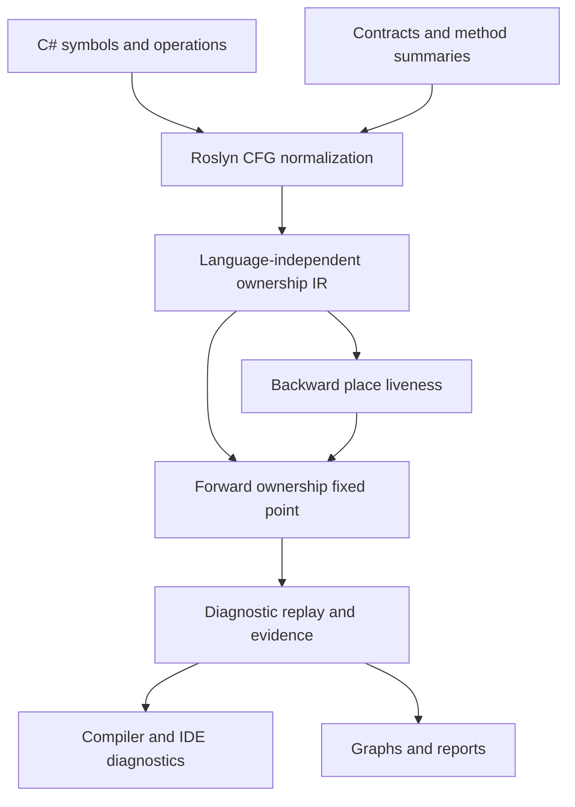

# Architecture and analysis contracts

## Boundaries

SafeSharp is an independent C# implementation inspired by Rust's borrow checker design. It does not embed Rust compiler code, translate C# into Rust, replace the CLR, or claim a proof of memory safety for arbitrary C#. Explicit ownership contracts and recognized resource APIs give the analyzer a model it can check. Ordinary unannotated C# reference assignment retains its runtime aliasing semantics.

`SafeSharp.Core` owns IR validation, abstract state, place overlap, loan liveness, transfer semantics, the fixed-point schedule, and results. It has no Roslyn dependency. `SafeSharp.Analyzers` owns symbol classification, contract summaries, CFG normalization, diagnostic descriptors, and compiler registration. Its services live for one compilation; there is no mutable global compilation cache. `SafeSharp.Reporting` only depends on Core and formats immutable results. `SafeSharp.Tool` owns file I/O, workspace loading, compiler-error handling, output selection and exit status. `SafeSharp.Contracts` contains the small public annotation vocabulary. `SafeSharp.CodeFixes` is an optional independent IDE package.

## Abstract domain

A place is a stable parameter/local/capture identity followed by zero or more projections. A resource is identified by its allocation site or external input. Places contain sets of abstract reference alternatives: resource identity, availability, loan origin, field projection, and moved subpaths. Resources carry ownership kind, lifecycle flags, acquisition evidence, and optional owning-scope identities. Loans carry shared/exclusive kind, reserved/active phase alternatives, holder, origin, activation sites, projection, reborrow ancestry, and suspension policy. Async disposal completions have a separate resource kind, pending/completed status, and provenance identifying the resource whose disposal they observe.

At a control-flow merge the engine retains alternatives. It does not collapse `alive OR disposed` into either `alive` or `disposed`. A finding is **definite** only when all represented alternatives violate the rule; otherwise it is **possible**. Absent allocations and place/resource correlations matter: two allocations in mutually exclusive branches must not look like two simultaneously leaked resources.

Moves invalidate existing aliases to the transferred value. A moved-to place obtains the current ownership handle; stale aliases do not regain access. Ordinary assignment preserves alias identity, so disposal through any alias affects the others. Reassignment starts a new local ownership value. Structural projections support overlapping aggregate/field access and partial moves; unknown array indices conservatively overlap. Heap aliases introduced by unmodeled APIs, reflection, native code or pointer arithmetic remain outside the proof boundary.

Allocation-site abstraction makes loops finite. It does not count concrete allocation instances. Reusing an allocation site must not reactivate a stale alias from an earlier iteration. The model and tests distinguish branch-local allocations, loop-carried aliases, repeated disposal, and owner overwrites.

## Solvers and non-lexical lifetimes

The backwards solver computes live places at each instruction. The forward worklist joins predecessor states, applies ownership effects, and expires loans according to those live sets. A loan can end before its variable's lexical block ends. Multiple shared borrows are compatible; an active exclusive borrow conflicts with overlapping loans. A reservation permits reads and shared borrowing during argument evaluation, then checks conflicts again on activation. Explicit exclusive loans start active. Every argument value remains live through the call, including explicit loans passed to unannotated parameters. Reborrows retain the necessary parent ancestry so the parent cannot be used while a child loan is active.

Diagnostics are replayed after convergence, preventing warnings based solely on transient solver states. Related locations identify concrete source origins and conflicting effects. Evidence is an abstract explanation, not a fabricated single feasible counterexample path: a may-analysis join may combine facts from different execution paths. JSON/SARIF/HTML preserve that distinction.

The engine is reentrant, uses finite resource/place/loan identities, checks cancellation, and imposes configurable resource and iteration limits. Reaching a limit emits `SS0015`; service dependency exploration has its own `SS0029`. Lifetime solving/provenance uses `SS0043`, and aggregate/concurrency composition and borrowed-escape provenance use `SS0046`. All appear as incomplete CLI analysis even if their visible diagnostic severity is suppressed. Snapshot capture is off inside ordinary compiler analysis, so detailed per-instruction snapshots are only materialized when a reporting caller requests them.

## C# control flow and exceptions

Roslyn represents `using` and `try/finally` with implicit cleanup continuations. Normalization makes these edges explicit and clones cleanup contexts for distinct return destinations. A return expression is evaluated before cleanup, but the returned ownership value is validated after cleanup. This catches returning a resource that a `using` declaration disposes while leaving the method.

Null tests are edge assumptions. Impossible null branches after known allocations must not create false leaks through skipped implicit disposal. The exception model separates explicit throw/catch/finally control flow from implicit exception boundaries; the implementation and tests cover the supported normalized cases. Ordinary unhandled exception safety is also audited by `SS0030`, which recommends structured cleanup where a later manual release can be bypassed.

An exception thrown by arbitrary native code or a partially executing disposal implementation cannot be reconstructed completely from an analyzer's method-local model. Arbitrary library calls also need summaries to expose retained aliases or ownership transfers. See the precise [Rust support matrix](rust-design.md) and [diagnostic limitations](diagnostics.md).

The caller's disposal obligation is discharged when the recognized cleanup operation is invoked, including when its implementation subsequently throws. The analyzer verifies the caller's release protocol; successful physical cleanup remains the implementation's responsibility. Consequently, a correct `using` inside a catchable region does not become a leak merely because `Dispose` itself may throw. Reusing the resource after that attempted cleanup is still diagnosed.

## Interprocedural and service analysis

Boundary summaries recognize explicit consuming, borrowing, mutation and return contracts. Source inference uses a bounded may-origin CFG analysis for fresh returned allocations, source aliases, branches, loops, wrapper calls, and owned out results. Unknown origins survive joins. Ref/out effects and initializer writes invalidate stale origins; bodies with exception handlers or ref-local storage aliases retain an opaque summary. Direct parameter disposal effects remain deliberately limited. It is not a whole-program virtual-dispatch or recursive effect proof. Known BCL factories, pools, memory-owner views and dependency-injection resolution methods supply additional summaries.

An implementation that omits parameter annotations inherits the interface or overridden declaration's contracts. Parameter relationships are mapped by ordinal, so renaming a parameter does not disconnect an inherited returned borrow. Incompatible explicit parameter modes produce `SS0034`. Getter summaries consult associated base/interface property annotations. Expression-bodied properties and indexers participate in direct fresh-result inference and receive the same report graphs as ordinary methods.

Cleanup recognition resolves the actual `IDisposable`/`IAsyncDisposable` interface implementation and its virtual overrides; a same-name unrelated method does not release a resource. Valid disposal patterns on ref structs are also recognized. Assignments through `ref`/`out` parameters store into caller-visible locations and transfer modeled ownership just as a longer-lived heap store does; `out` parameters have no incoming value. Fresh owned out results can be inferred from all modeled normal exits or declared with `[Owned] out`. The caller replaces the slot only after a successful call. Arbitrary ref-slot postconditions and retained aliases of unknown external calls remain opaque.

`BorrowedEscapeAnalysis` checks persistent retention of declared borrowed/no-escape parameters in a separate CFG domain. Direct origins, allocation containers, captured cells and reference targets remain distinct: evaluating a value snapshots its origin, whereas a delegate can retain mutable storage. The solver shares compilation-scoped call summaries, propagates may sets to a fixed point, and emits SS0027 from converged states. Exception handlers and nested-function captures receive a conservative value history; this intentionally does not claim the core's more detailed exception routing. The [borrowed-escape guide](borrowed-escape.md) describes return exemptions, the stricter no-escape contract, field-insensitive containers, bounds and source evidence.

The service analyzer builds a separate constructor-dependency graph from annotated lifetimes and supported registration syntax. It detects transitive singleton capture of scoped dependencies and retains the dependency path as metadata. Container-created values remain borrowed/container-owned. A local scope relationship allows the ownership engine to detect service use after scope disposal. Factories, custom containers, runtime registration mutation, keyed matching and reflection require the documented qualifications.

## Named regions and aggregate obligations

`Core.Regions` accepts an immutable region problem independently of Roslyn. The solver constructs a deterministic implication closure, equivalence components and shortest declared-edge proofs, or an explicitly incomplete result with no partial proofs. The Roslyn lifetime adapter maps parameters by ordinal, checks inherited signature promises, and analyzes returned origins without importing caller-specific objects into a global symbol cache. Return candidates are joined using `MergeAlias` before a loan is created; alternative sources are not incorrectly represented as simultaneous exclusive loans. See [lifetime regions](lifetime-regions.md).

Aggregate cleanup has its own obligation domain and source-helper summaries. It retains a member obligation if any modeled normal path keeps it, distinguishes replacement resources, specializes boolean disposal-pattern arguments, and expands finally continuations. Every sync/async disposal entrypoint is checked separately. Its conservative exceptional routing is documented independently from the core's normalized ownership CFG; neither layer claims physical cleanup after arbitrary exceptional termination. See [aggregate and concurrency contracts](aggregate-concurrency.md).

`DisposeAsync` lowering invokes disposal, marks the potential synchronous throw, then creates the completion obligation on the successful edge. Awaiting observes that completion before propagating its asynchronous fault. The owned resource and its completion therefore have distinct states and evidence. [Advanced engine protocols](advanced-engine.md) documents the IR effects, phase and completion lattices, supported wrappers, and graph representation.

## Extension points

- Add another language frontend by producing `AnalysisGraph` and `FlowInstruction` values; Core remains reusable.
- Embed `OwnershipCompilationAnalysis.Analyze` in a custom Roslyn tool and request snapshots explicitly.
- Use `SafeSharpAnalyzerCatalog.Create()` to run the same complete compiler analyzer set as the CLI.
- Implement `IAnalysisReportWriter` for another deterministic export format.
- Extend contract summaries and registration recognition independently of the solver.

Each abstraction owns one task. Exporters do not reach into Roslyn, compiler callbacks do not write files, and the core domain does not depend on IDE services.
