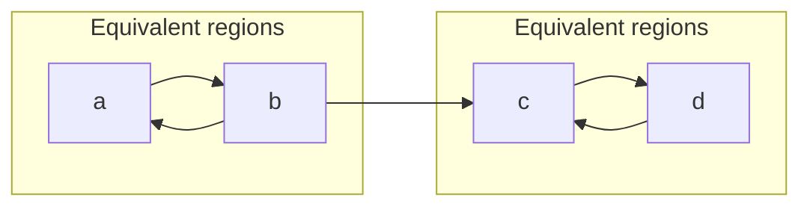

# Explicit lifetime regions

SafeSharp provides a reusable named-region constraint solver and a Roslyn analyzer that checks explicit borrowed-return lifetime promises. A method can name the lifetimes supplied by its caller, declare which lifetimes outlive others, and return a loan whose provenance satisfies those relations.

The implementation has two parts. `SafeSharp.Core.Regions` computes outlives implications, equivalent-region components, and deterministic proof witnesses without depending on Roslyn. `LifetimeContractAnalyzer` binds those regions to actual C# parameters and returned values, follows their provenance through control flow, and checks inherited contracts. The normal ownership analyzer uses the same resolved contracts for caller-side borrowing effects.

## Contracts and meaning

```csharp
using SafeSharp;

[Outlives("owner", "view")]
[return: Lifetime("view")]
static Resource View([Borrowed, Lifetime("owner")] Resource owner)
{
    return owner;
}
```

`owner : view` means the `owner` region must remain valid for at least the duration promised by `view`. It permits a value with source region `owner` to satisfy the returned `view` region. Reversing that relation does not establish the required promise. Equal names are reflexively related, and declared constraints imply transitive relationships.

| Contract | Attribute targets | Public metadata |
| --- | --- | --- |
| `Lifetime("a")` | Parameter, return value | `LifetimeAttribute.Name` |
| `Outlives("a", "b")` | Method; repeatable | `OutlivesAttribute.Longer`, `.Shorter` |

Names are scoped to a method signature. Parameter annotations and the return annotation introduce names; an `Outlives` declaration must reference names in that signature. The reserved name `this` denotes an instance receiver's region and is unavailable on static methods. It can be used as the return region or in an outlives relation, for example `[return: Lifetime("this")]` on a receiver-bound result.

The Roslyn contracts require identifier names, with `this` as the explicit exception. The compiler-independent solver accepts arbitrary nonempty names without embedded null characters. Neither API changes CLR object lifetime, C# assignment, garbage collection, or runtime accessibility.

`Lifetime` states a duration relationship. Use `Borrowed` or `BorrowedMut` to describe access capability, including `[return: BorrowedMut]` for a mutable returned loan, and `ReturnsBorrowed("parameter")` when the result must originate from one particular input. A lifetime-bound parameter cannot also consume ownership. A lifetime-bound borrowed result conflicts with `ReturnsOwned` or an owned return annotation, and a returned loan cannot simultaneously declare `Borrowed` and `BorrowedMut`. A factory producing a new owner should use an owned-return contract instead.

## Several inputs and all possible returned sources

```csharp
[return: Lifetime("shared")]
static Resource Choose(
    [Borrowed, Lifetime("shared")] Resource first,
    [Borrowed, Lifetime("shared")] Resource second,
    bool chooseFirst)
{
    return chooseFirst ? first : second;
}
```

The implementation checks both possible origins. At a call site, the returned loan retains the union of candidate input origins associated with the result's region. It never selects the first matching parameter and silently loses the other candidate.

Different input names can support a common returned name through constraints:

```csharp
[Outlives("first", "result")]
[Outlives("second", "result")]
[return: Lifetime("result")]
static Resource Choose(
    [Borrowed, Lifetime("first")] Resource first,
    [Borrowed, Lifetime("second")] Resource second,
    bool chooseFirst) => chooseFirst ? first : second;
```

Without the second outlives relation, the branch returning `second` does not establish the promise. A stronger explicit `ReturnsBorrowed("first")` relation additionally restricts origin to `first`; a long enough lifetime on `second` does not override that source promise.

## What the body checker follows

The return checker obtains real Roslyn control-flow graphs and computes a finite set of possible origins for each local, parameter, and flow capture. Assignment replaces a local's current origin. Branch joins retain every alternative, and loops iterate to a fixed point. Diagnostics are emitted from the converged states rather than intermediate iterations.

Implemented provenance includes:

- Direct parameters, instance receivers, aliases, reassignment, and flow captures.
- Conditional and coalescing values, including multiple explicit return paths.
- Ordinary local loops and recognized local reference aliases/rebinding.
- Distinct symbol-based storage for captured outer parameters and a nested function's own parameters; an unknown capture cannot acquire an input lifetime merely because their parameter ordinals match.
- Calls with explicit borrowed-source or lifetime contracts, and source summaries accepted by the method-origin analysis.
- Unions of several borrowed input candidates, including inferred multi-source summaries.
- Known ownership helpers, `Memory<T>.Span`, `ReadOnlyMemory<T>.Span`, and the actual `IMemoryOwner<T>.Memory` interface member/implementation. An arbitrary property returning a memory-view type does not establish an owner relation.
- Owned instance fields whose ownership relates them to their receiver.
- Explicitly unknown results from arbitrary calls, properties, fields, or unsupported value operations.
- Conservative invalidation of arguments that a `ref`/`out` call or constructor can replace.
- Conservative invalidation after compound/deconstruction updates and calls which may overwrite captured caller storage, including non-static local functions, delegate invocation, and callback arguments. Static local-function summaries remain usable without that capture invalidation.

For example, the following overwrite is checked using the final alias value:

```csharp
[return: Lifetime("a")]
static Resource Invalid(
    [Lifetime("a")] Resource first,
    [Lifetime("b")] Resource second)
{
    var alias = first;
    alias = second;
    return alias; // SS0041: b is not known to outlive a.
}
```

Fresh local construction, an owned factory result, or a newly allocated array cannot establish an external borrowed lifetime merely because the result is returned. A returned null carries no resource-lifetime obligation. An unknown origin remains unknown at a merge; a valid branch cannot erase an unverified alternative.

The region checker and disposal checker have distinct responsibilities. Named-region proofs relate source and result lifetimes. The ownership engine checks moves, loans, cleanup, and use after disposal. A region relation does not authorize releasing a borrowed object or returning an already disposed owner.

## Interface and override compatibility

Unannotated implementations inherit their interface/base promises. Parameters are matched by ordinal, so ordinary parameter renaming does not break the contract. Explicit region names may also be renamed consistently:

```csharp
interface IView
{
    [return: Lifetime("a")]
    Resource View([Lifetime("a")] Resource source);
}

sealed class ViewProvider : IView
{
    [return: Lifetime("x")]
    public Resource View([Lifetime("x")] Resource renamed) => renamed;
}
```

The contract resolver maps inherited region relationships into the implementation signature. Omitted parameter, return, and outlives annotations inherit the applicable declarations. A method's inherited `ReturnsBorrowed` parameter name is also remapped by ordinal.

Compatibility checks reject an implementation that introduces additional input outlives requirements, changes an owned result into a borrowed result or vice versa, redirects a named returned loan to another parameter/receiver, changes its declared mutability, or adds return-source candidates that cannot satisfy the inherited lifetime promise. Transitive implications are considered, so merely restating an already implied relation does not introduce a new requirement.

This is an explicit-contract compatibility check. It does not prove every aspect of behavioral subtyping, such as arbitrary exception effects, synchronization, generic variance, or higher-ranked lifetime quantification. Contracts at external and virtual call boundaries remain trusted descriptions of behavior.

## Reusable region solver

The public API resides in `SafeSharp.Core.Regions`:

```csharp
using SafeSharp.Core;
using SafeSharp.Core.Regions;

var problem = new RegionProblem(
    new[] { "a", "b", "c", "d" },
    new[]
    {
        new RegionConstraint("a", "b", new SourceSite("example.cs", 10, 4)),
        new RegionConstraint("b", "a", new SourceSite("example.cs", 20, 4)),
        new RegionConstraint("b", "c", new SourceSite("example.cs", 30, 4)),
        new RegionConstraint("c", "d", new SourceSite("example.cs", 40, 4)),
        new RegionConstraint("d", "c", new SourceSite("example.cs", 50, 4)),
    });

var result = new RegionConstraintSolver().Solve(
    problem,
    new RegionSolverOptions(maxRegions: 256, maxConstraints: 4096, maxSteps: 100000),
    cancellationToken);

if (!result.IsComplete)
    throw new InvalidOperationException(result.BudgetReason);

bool equivalent = result.AreEquivalent("a", "b"); // true
bool outlives = result.Outlives("a", "d");         // true
RegionProof? proof = result.GetProof("a", "d");    // a -> b -> c -> d
```

The example has two strongly connected components:



Cycles are valid: mutual outlives constraints establish equivalence. They are not inherently contradictory lifetime declarations. The component representatives and members are ordered deterministically. `AreEquivalent("a", "c")` is false here, while `a` still outlives `c` through the connecting edge.

| Result member | Meaning |
| --- | --- |
| `IsComplete` | Whether the bounded solve completed. |
| `BudgetReason` | The exceeded resource limit, when incomplete. |
| `Steps` | Counted graph-solving and proof-construction work. |
| `Components` | Strongly connected components and lexical representatives. |
| `Implications` | Every proved reflexive or transitive outlives relationship. |
| `GetProof(longer, shorter)` | A shortest deterministic sequence of original constraints, or null. |
| `Outlives(longer, shorter)` | Whether that implication was proved. |
| `AreEquivalent(first, second)` | Whether both names belong to the same computed component. |

The solver snapshots input collections and rejects undeclared constraint endpoints. Its SCC passes use explicit stacks rather than recursive graph traversal. Breadth-first searches construct shortest implication witnesses over the original constraint edges, preserving source sites and reasons. Ties are resolved by stable region, source-location, and reason ordering. A reflexive proof has no synthetic source edge.

The solver is reentrant and has no mutable global state. Cancellation is observed during graph traversal and proof construction. An incomplete solution deliberately exposes no partial components or proofs: callers must check `IsComplete` before interpreting a missing implication as an established lack of relation.

## Diagnostics

All four rules are enabled warnings in category `SafeSharp.Lifetimes`.

## SS0040

**Lifetime declaration is invalid.** The declaration contains an invalid region identifier, an unknown outlives endpoint, a static use of `this`, a lifetime on a void result, or a contradictory ownership/lifetime mode. An explicit returned `Borrowed`/`BorrowedMut` annotation must also agree with the mutability argument of an explicit `ReturnsBorrowed` source contract.

```csharp
[Outlives("a", "missing")] // SS0040
static void Inspect([Lifetime("a")] Resource source) { }
```

Correct the name or introduce the intended named region on a parameter/result. A constraint alone does not introduce a free region name. Use ownership contracts for newly owned results, and reserve returned lifetime contracts for loans. Invalid declarations are diagnosed before attempting a body proof.

## SS0041

**Returned borrow does not satisfy its lifetime.** At least one return origin cannot satisfy the declared region/source relationship. The cause may be a missing outlives relation, a different borrowed source, a locally created owner, or an unmodeled origin whose lifetime is unknown.

```csharp
[return: Lifetime("b")]
static Resource Invalid([Lifetime("a")] Resource source) => source; // SS0041
```

If the API requires `a` to outlive `b`, express that contract and make its callers respect the relationship. Otherwise return a value with the correct source, narrow the promised lifetime, or return ownership explicitly. Do not add a false outlives declaration merely to silence a result that is actually tied to a local owner.

The diagnostic points to the returned expression. Related locations and stable properties retain evidence:

| Property | Content |
| --- | --- |
| `SafeSharp.RequiredRegion` | The promised output region, when named. |
| `SafeSharp.ReturnBorrowedSource` | A required source parameter or receiver, when declared. |
| `SafeSharp.RegionNames` | All valid solved names in ordinal order, separated by comma-space. |
| `SafeSharp.RegionComponents` | Equivalent-name groups, separated by semicolon-space. |
| `SafeSharp.SourceRegions` | The analyzed origin-region alternatives; categories use `<Unknown>`, `<Local>`, and `<Null>` so they cannot collide with valid region identifiers. |
| `SafeSharp.RegionConstraints` | Declared outlives relations used for the method. |
| `SafeSharp.RegionProof` | Available successful implication paths among those alternatives. |

An unknown-origin diagnostic states that the promise was not established; it does not invent an executable counterexample or a dangling CLR pointer.

## SS0042

**Implementation changes a lifetime or return promise.** An interface/base caller and a concrete implementation would observe incompatible explicit ownership, returned-source, mutability, or named-region requirements.

```csharp
interface IChoice
{
    [ReturnsBorrowed("first")]
    Resource Pick(Resource first, Resource second);
}

sealed class Choice : IChoice
{
    [ReturnsBorrowed("second")]
    public Resource Pick(Resource first, Resource second) => second; // SS0042
}
```

Make the implementation satisfy the inherited promise, or change the public abstraction and review its callers together. Consistent parameter/region renaming is accepted. The diagnostic includes the inherited declaration as related evidence.

## SS0043

**Lifetime region analysis reached its budget.** Named regions, constraints, solving/proof steps, or returned-origin analysis exceeded the permitted work. The result is explicitly incomplete.

```editorconfig
[*.cs]
safesharp_max_regions = 256
safesharp_max_region_constraints = 4096
safesharp_max_region_steps = 100000
```

These are the defaults. Per-file limits are capped at 4,096 region names, 100,000 constraints, and 10,000,000 steps. The implicit instance receiver region contributes to the name count. The return-provenance analysis also caps recursive operation depth at 256 and charges operation visits, origin-set merges, state copying/comparison, and diagnostic evidence to its step limit. Inherited signature comparisons have a separate counter using the same configured step limit and observe cancellation within parameter-pair checks. These counters are separate from the ownership engine's SS0015 budget.

Ordinary unannotated bodies are pruned before CFG construction, while annotated nested local functions remain discoverable. These are analysis-work limits, not a hard timeout for Roslyn parsing, semantic binding, or graph construction.

Reduce unnecessary signature/body complexity or increase a measured, appropriate limit. Suppressing this warning does not complete the proof. No partial return findings are emitted as if analysis had completed successfully.

## Implemented scope and remaining boundaries

| Capability | Status |
| --- | --- |
| Explicit method-scoped named regions | Implemented. |
| Outlives graph, reflexivity, transitivity, SCC equivalence | Implemented. |
| Deterministic source-bearing implication proofs | Implemented. |
| Bounded/cancelable reusable solver | Implemented. |
| Parameters, receivers, aliases, ordinary branches/loops, multiple return sources | Implemented with conservative unknown origins. |
| Trusted call summaries and multi-source return propagation | Implemented. |
| Omitted inherited contracts and positional region/parameter renaming | Implemented. |
| Basic inherited input and returned-lifetime compatibility | Implemented. |
| Full type-level region inference, higher-ranked binders/universes/placeholders | Not implemented. |
| Complete generic variance, nested type-lifetime tests, automatic closure lifetime generalization | Not implemented. |
| Arbitrary heap/container/native aliases and every external library effect | Require models/contracts; unknown origins are not accepted as proofs. |
| Full region-state reconstruction across exceptional handler entries | Conservative: unchanged parameters remain known; parameters that may have been replaced and missing local facts become unknown. |
| Exact path feasibility from arbitrary correlated conditions | Not implemented; joins retain possible alternatives. |
| Runtime enforcement or a proof of arbitrary C# memory safety | Not provided. |

The separate ownership engine models many disposal and exception paths in greater detail. This explicit-region checker does not silently reuse that fact as a proof of every region origin at an exception handler. Similarly, a method result with no usable input/receiver lifetime bound remains unknown when a caller needs such a proof.

## Rust design and code references

The implementation is original C#. It adopts the explicit outlives-constraint and provenance ideas documented by Rust without embedding rustc or claiming full Rust region/type-system parity.

- [Rust Reference: lifetime bounds](https://doc.rust-lang.org/reference/trait-bounds.html#lifetime-bounds) defines the meaning of an outlives relation.
- [Rust compiler guide: region inference](https://rustc-dev-guide.rust-lang.org/borrow-check/region-inference.html) separates universally supplied regions, constraints, propagation, and validation of required bounds.
- [Rust compiler guide: constraint propagation](https://rustc-dev-guide.rust-lang.org/borrow-check/region-inference/constraint-propagation.html) explains graph edges and equivalent regions found through SCCs.
- [Rust compiler `RegionInferenceContext`](https://doc.rust-lang.org/beta/nightly-rustc/rustc_borrowck/region_infer/struct.RegionInferenceContext.html) exposes `constraint_sccs`, `solve`, `eval_outlives`, and `constraint_path_between_regions`, with links to the corresponding Rust implementation.

SafeSharp's named-region graph is intentionally smaller: it does not represent rustc's full set of MIR points, universe placeholders, type tests, or higher-ranked region constraints. Its BFS witness generation is a diagnostic/provenance service over the explicit graph, while its separate C# control-flow analysis checks actual returned origins against the solved promises.
