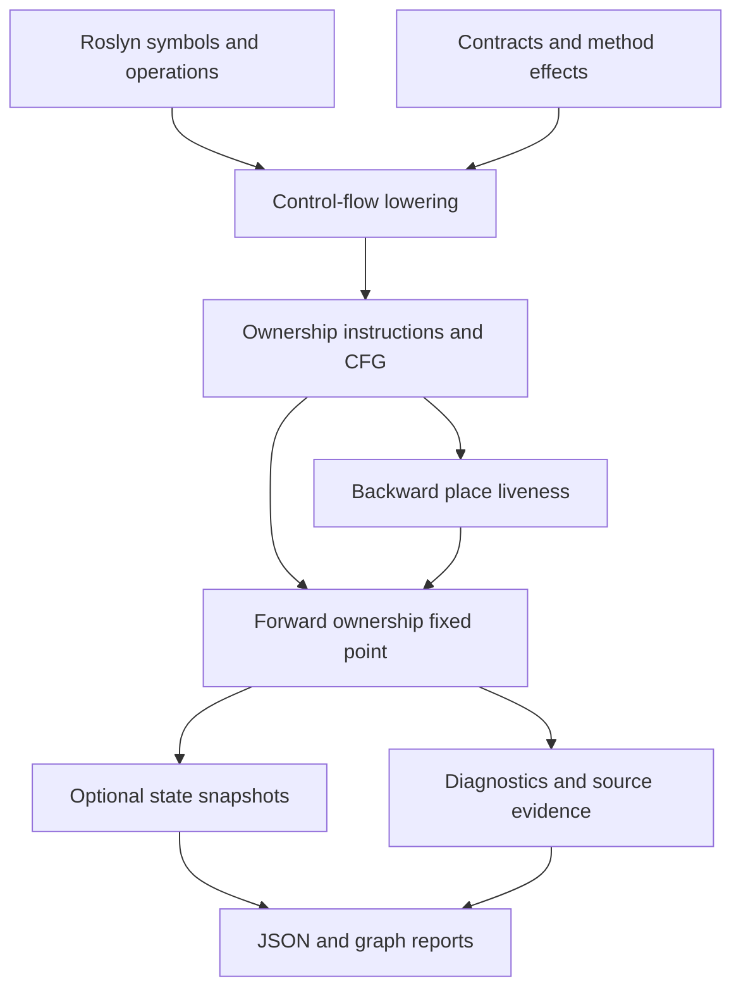

# Rust design references and the C# ownership model

SafeSharp is an independent C# analysis implementation informed by Rust's borrow-checker architecture. The reusable engine works over explicit ownership effects and a finite control-flow graph, with forward ownership dataflow, backward place liveness, and source-grounded diagnostic evidence. It does not embed rustc, translate the Rust compiler, or change the C# language's assignment and garbage-collection semantics.

## Reference baseline

Source references are pinned to **Rust 1.91.0**, commit **`f8297e351a40c1439a467bbbb6879088047f50b3`**, instead of a moving development branch. The official `1.91.0` annotated tag was resolved through GitHub to that commit. This is a reproducible design reference, not a claim that the implementation matches every rule in that release or tracks the latest Rust compiler.

| Reference | Design subject | SafeSharp relationship |
| --- | --- | --- |
| [`rustc_borrowck/src/lib.rs`](https://github.com/rust-lang/rust/blob/f8297e351a40c1439a467bbbb6879088047f50b3/compiler/rustc_borrowck/src/lib.rs) | Borrow-checking query and coordinated analyses | Separate language lowering, dataflow solving, and diagnostics. |
| [`rustc_borrowck/src/dataflow.rs`](https://github.com/rust-lang/rust/blob/f8297e351a40c1439a467bbbb6879088047f50b3/compiler/rustc_borrowck/src/dataflow.rs) | Borrow and initialization analysis domains | A reusable finite abstract domain with fixed-point iteration. |
| [`rustc_borrowck/src/places_conflict.rs`](https://github.com/rust-lang/rust/blob/f8297e351a40c1439a467bbbb6879088047f50b3/compiler/rustc_borrowck/src/places_conflict.rs) | Place projections and overlap | Resource identity and field-projection conflict checks. |
| [Rust Compiler Development Guide: borrow checking](https://rustc-dev-guide.rust-lang.org/borrow-check.html) | MIR as a lowered analysis representation | Roslyn `IOperation` and CFG are lowered to compiler-independent ownership instructions. |
| [Rust RFC 2094: non-lexical lifetimes](https://rust-lang.github.io/rfcs/2094-nll.html) | Lifetimes determined by control flow and use | Backward liveness expires modeled loans after their last relevant use. |
| [Rust Compiler Development Guide: region inference](https://rustc-dev-guide.rust-lang.org/borrow-check/region-inference.html) | Region constraints and outlives relationships | Informs compact region closure, returned provenance, explicit nested contracts and caller-versus-callee obligations; full Rust type/trait inference remains outside the model. |
| [`region_infer/mod.rs`](https://github.com/rust-lang/rust/blob/f8297e351a40c1439a467bbbb6879088047f50b3/compiler/rustc_borrowck/src/region_infer/mod.rs) and [`handle_placeholders.rs`](https://github.com/rust-lang/rust/blob/f8297e351a40c1439a467bbbb6879088047f50b3/compiler/rustc_borrowck/src/handle_placeholders.rs) | Placeholder visibility, universe tracking and visible upper bounds | Higher-ranked region solving intersects reachable visibility and records static promotions and original leak witnesses. The public API also checks sibling binder isolation. |
| [`rustc_type_ir/src/relate.rs`](https://github.com/rust-lang/rust/blob/f8297e351a40c1439a467bbbb6879088047f50b3/compiler/rustc_type_ir/src/relate.rs) | Variance composition when relating types | Roslyn-declared variance and explicit TypeLifetime paths determine covariant, contravariant and invariant obligations. |
| [`rustc_borrowck/src/type_check/relate_tys.rs`](https://github.com/rust-lang/rust/blob/f8297e351a40c1439a467bbbb6879088047f50b3/compiler/rustc_borrowck/src/type_check/relate_tys.rs) | Structural type relations and generated outlives requirements | Direct invocation checks reuse the nested binder while keeping caller evidence separate from callee obligations and refusing unknown content proofs. |
| [`core/src/future/future.rs`](https://github.com/rust-lang/rust/blob/f8297e351a40c1439a467bbbb6879088047f50b3/library/core/src/future/future.rs) | Future versus Output and completion protocols | Separate nested carriers, terminal output identity, completion observation and ValueTask consumption; .NET Task/ValueTask contracts determine the actual rules. |
| [`std::sync` Mutex/MutexGuard](https://github.com/rust-lang/rust/blob/f8297e351a40c1439a467bbbb6879088047f50b3/library/std/src/sync/poison/mutex.rs) and [RwLock guards](https://github.com/rust-lang/rust/blob/f8297e351a40c1439a467bbbb6879088047f50b3/library/std/src/sync/poison/rwlock.rs) | Guard-mediated access, reader/writer capabilities and release responsibility | Explicit GuardedBy/RequiresLock conventions and supported CLR protocols. C# reentrancy, exception filters, thread-affine locks and non-thread-affine SemaphoreSlim permits have distinct transfer rules. |
| [Rust Compiler Development Guide: two-phase borrows](https://rustc-dev-guide.rust-lang.org/borrow-check/two-phase-borrows.html) | Reservation followed by activation | Implemented for implicit mutable receivers and BorrowedMut arguments; explicit loans remain active at creation. |
| [Polonius: loan analysis](https://rust-lang.github.io/polonius/rules/loans.html) | Loan propagation, invalidation, and origin relations | Related design literature; SafeSharp uses its own abstract-state solver, not the Polonius engine. |

No Rust implementation code was copied into SafeSharp. References in source comments identify the ideas being adapted. The authoritative descriptions above explain Rust; the source files and tests in this repository define what SafeSharp actually computes.

## Lowering and analysis pipeline



Roslyn performs C# binding and type checking. SafeSharp's frontend identifies resource construction, aliases, explicit moves and loans, calls with known ownership effects, disposal, transfers, escaping references, and suspension points. Each effect becomes a `FlowInstruction` in an `AnalysisGraph`. A custom language frontend can generate that same representation without a Roslyn dependency.

The graph preserves the edges supplied by the frontend. The engine does not reinterpret source expressions, discover omitted exception edges, or assume that an arbitrary library call is pure. The Roslyn frontend models explicit throws and rethrows, typed catches, filters, and cleanup continuations. Potentially throwing operations are split at explicit effect markers and routed to visible catch/finally continuations. Filter search occurs before inner finally cleanup; a throwing filter follows its false path. A missing frontend effect cannot be recovered by a sophisticated graph solver; soundness claims must therefore include the lowering and the external contracts, not just the core lattice.

### Forward ownership state

The abstract state has cooperating finite domains:

1. **Places** map local or projected identities to possible resource references. A reference records availability, loan identity, projection, and moved subprojections. C# aliases remain connected to the same resource identity.
2. **Resources** carry ownership obligations and possible lifecycle states: absent, alive, disposed, transferred, or escaped. An allocation site can also be associated with owner scope resource identities.
3. **Loans** record a shared or exclusive borrow, the resource/projection being borrowed, its holder, origin, parent loan, and suspension policy.
4. **Reference storage** maps ref bindings to flattened target locations independently of evaluated values. Represented array refs and indexed accesses share canonical aggregate cells. Singleton targets permit strong updates; alternative/wildcard targets retain weak effects, and captured writable addresses are weakened before exceptional filter/unwind continuations.
5. **ValueTask capabilities** retain single-consumption identity and available/consumed/transferred alternatives across aliases. Reusable Task/Preserve results follow their separate modeled protocol.
6. **Async/aggregate facts** retain carrier depth, composition dependencies and canonical represented element identities. Loop summaries can require weak element updates.

The solver joins predecessor states and iterates to a fixed point. A state can record alternatives such as alive on one branch and disposed on another. The checker reports whether a misuse is definite or possible within the abstract model. Allocation-existence information prevents an allocation that occurs in one branch from being treated as an undisposed concrete allocation on an unrelated branch where it never existed. Explicit null/non-null assumptions prune infeasible guard edges and refine nullable-reference facts.

Resources are abstract allocation identities. They are not runtime addresses, and one loop allocation site may summarize multiple concrete instances. Liveness permits a strong refresh of a loop allocation when old aliases are dead, avoiding contamination of a new `using` iteration by a previous iteration's disposed state. It does not establish general concrete instance cardinality. A field projection expresses a place-access relationship; an independently disposable child field requires its own resource identity when the frontend models a separate disposal obligation. Disposing or transferring a projected field must not automatically discharge the containing object's obligation.

### Backward liveness and loan expiry

The liveness analysis computes place sets at block boundaries and before/after each instruction, over the actual control-flow successors. The forward analysis uses those sets to remove loans whose holders no longer have a relevant future use. This permits an owner to be used after a temporary borrowed view's last use, without requiring a new lexical block.

A write through an existing ref still uses its captured address. It keeps the referenced aggregate generation live even if the next operation only overwrites the cell; replacing or releasing the binding ends the former address relationship. This is C# storage-location semantics, separate from the lifecycle of the resource currently stored in the cell. Canonical ref coherence does not derive deep-container child loans or every parent-loan permission associated with the array.

Reborrows retain parent-loan information. A live child can preserve the restrictions associated with its borrow ancestry. Field projections support conflicts on overlapping paths and independence of distinct modeled fields; unknown indices or external aliases are not solved symbolically.

Local liveness and named signature regions are separate analyses. `[Lifetime]` and `[Outlives]` supply explicit first-order constraints that C# types do not encode; a bounded solver computes reflexive/transitive implications and strongly connected equivalence classes with shortest source-backed proofs. Returned provenance must satisfy the declared region. Multiple possible sources remain alternatives at the caller. The universal solver rejects delegate conversions whose requirements imply an unpromised relationship between arbitrary caller lifetimes.

The higher-ranked domain opens lexical universes for nested callable contracts and introduces rigid placeholders. Visibility is intersected across reachable regions, including older inference variables. A requirement to contain an unnameable placeholder needs a visible static upper bound; any resulting new rigid relation must follow from the caller's assumptions. This follows the pinned placeholder/universe design, adapted to an explicit binder tree and shortest relation evidence. `[TypeLifetime]` paths compose declared Roslyn variance, callable input/output polarity and array/ref invariance. Scoped `[TypeOutlives]` obligations and supported implied input/owner bounds use opaque structural type identities supplied by the Roslyn adapter. C# metadata does not encode Rust reference types: these annotations are explicit contracts, not automatic inference of every generic argument's contents. See [higher-ranked regions](higher-ranked-regions.md) and [type lifetime contracts](type-lifetimes.md), alongside the earlier [named regions](lifetime-regions.md), [universal regions](universal-regions.md) and [delegate conversion](lifetime-delegates.md) APIs.

Direct-call checks instantiate explicit input type paths and outer type bounds against the caller's declared facts and the actual supplied arguments. The existing structural solver handles nested binders and variance; named arguments, inherited signatures, generic substitution and reduced extensions preserve their parameter relationships. A required nonempty invocation extent prevents missing bounds from succeeding through vacuous inference. Compilation-scoped immutable summaries invalidate content evidence after represented mutation, alias escape, reference exposure or opaque effects, with conservative loop/deferred handling and explicit budgets. SS0050 records a failed obligation or missing evidence; SS0043 records an incomplete proof. See [direct-call lifetimes](direct-call-lifetimes.md).

### Diagnostics after convergence

The engine solves states before reporting misuse diagnostics. This keeps intermediate worklist states from producing transient findings. Evidence points back to allocations, transfers, disposals, borrow origins, or exits involved in the abstract explanation. Multiple paths can contribute to one joined result.

An evidence list is consequently **provenance**, not a proven execution trace. JSON, HTML, and SARIF retain that distinction. Budget exhaustion produces an explicit incomplete-analysis result instead of treating an unfinished solver as a successful check.

## Mapping ownership into C#

Rust moves are language semantics. C# reference assignments create aliases, and value assignments can copy structs. SafeSharp preserves those C# facts. Ownership transfer is represented by a known consumption contract or the explicit `Ownership.Move` helper:

```csharp
using SafeSharp;

static void Consume([Consumes] MemoryStream stream)
{
    stream.Dispose();
}

static void Example()
{
    var first = new MemoryStream();
    var alias = first;
    var second = Ownership.Move(first);
    Consume(second);

    // The alias still refers to the same resource identity; move/disposal effects
    // remain visible to analysis, even though the CLR reference itself is non-null.
    alias.WriteByte(1);
}
```

The helpers return their arguments unchanged. They do not create runtime wrappers, clear variables, revoke references, or enforce exclusivity at execution time. The analyzer diagnoses violations in the modeled code. Annotating an API is a contract and must agree with its implementation.

The disposal obligation is an **invocation obligation**. A recognized `Dispose` invocation discharges it before an exception from the disposer body is propagated. This makes `using` cleanup and explicit cleanup consistent in the analysis. It does not prove that a throwing or partially implemented disposer released every underlying resource successfully. The abstract `Disposed` state records the recognized disposal effect, not a verified physical-cleanup postcondition.

Shared and exclusive loans use `Ownership.Borrow`/`Ownership.BorrowMut` or corresponding parameter/return contracts. `[Mutates]` declares receiver mutation where an API's intent is not expressible through ordinary C# reference mutability. `[ReturnsBorrowed("value")]` binds a return to a parameter; `"this"` denotes an instance receiver. Further annotations describe owned results, non-escaping parameters, mandatory result use, suspension restrictions, and thread-affinity conventions. See [contracts and semantic analysis](contracts-and-semantics.md) for their exact use and validation.

## Implemented capability map

| Concern | Implemented mechanism | Scope of the guarantee |
| --- | --- | --- |
| Use after disposal | Aliases share an abstract resource lifecycle. | Modeled resource identities and disposal effects. |
| Repeated disposal | Checks disposed state before a later modeled disposal. | Recognized `Dispose`/`DisposeAsync` effects; API idempotence is not inferred. |
| Missing disposal | Checks retained owned obligations at modeled exits and overwrites. | Declared/modeled ownership; unmodeled exception behavior is outside this core result. |
| Use after move | Reference availability and transferred ownership effects. | Explicit moves and consumption contracts; ordinary C# assignments retain alias semantics. |
| Shared/exclusive borrowing | Loan conflict rules for reads, writes, moves, and disposal. | Known borrowers and modeled place/resource overlap. |
| Non-lexical loan lifetimes | Backward CFG place liveness and expiry at instruction boundaries. | Intraprocedural liveness plus explicit borrowed-result contracts. |
| Reborrowing | Parent-loan ancestry and conflict tracking. | A derived exclusive loan cannot erase a shared/reserved ancestor restriction. |
| Two-phase borrowing | Exclusive reservation during argument evaluation, followed by activation at the call. | Implicit Mutates receivers and BorrowedMut arguments; explicit BorrowMut/ref loans remain immediate. |
| Evaluated call values | Stable by-value argument/receiver snapshots and consumption at call entry. | Preserves C# evaluation order when later arguments reassign storage or throw; explicit moves remain expression-time effects. |
| Named signature regions | Outlives closure, SCC equivalence, deterministic proofs and returned-provenance checking. | Explicit first-order names and constraints, including inherited contracts and multi-input returns. |
| Higher-ranked delegate/type regions | Nested lexical universes, placeholder visibility, static promotion/leak checking, explicit type paths, declared variance, scoped and supported implied bounds, inherited generic substitution and shortest proofs. | Corresponding annotated paths in delegate/inherited-contract comparisons; no automatic content inference, complete nominal projection or Rust trait/type solver. |
| Direct-call lifetime/type obligations | Stable caller evidence and declared bounds checked against explicit input TypeLifetime and TypeOutlives requirements, with the same nested binder and solver. | Supported parameter/local-alias, inherited, generic and reduced-extension mappings; cached conservative invalidation withholds proofs for mutated, unknown or unsupported projected contents. |
| Source and core reference storage | Indexed value slots, canonical aggregate cells, flattened ref targets, ref reassignment, evaluated call locations, source ref-return targets, normal-exit write summaries and exceptional writable-cell invalidation. | Singleton strong/alternative weak updates and captured-address liveness; unknown external storage and exact exceptional interprocedural write histories remain conservative. Deep-container parent-loan permissions are separate. |
| Exception-aware source summaries | Filter search before unwind, handler selection, nested finally continuations and return validation after cleanup. | Shared bounded router for source origins/lifetime returns; source-inference exhaustion yields an opaque summary. The separate borrowed-escape domain retains conservative handler histories. |
| Persistent borrowed storage | Converged CFG provenance over aliases, ref slots, containers and captured cells; stricter DoesNotEscape return/consumption checks. | Declared input origins, field-insensitive allocation containers and conservative handler/capture histories; see [borrowed escapes](borrowed-escape.md). |
| Field projections and partial moves | Projection-aware reference and loan state. | Static modeled paths; no complete heap-shape or symbolic index reasoning. |
| Branches, joins, loops | Bounded fixed-point iteration over a finite domain. | The supplied CFG and abstract allocation identities. |
| Nullable control flow | Null/non-null assumptions refine references and prune infeasible edges. | Recognized guards and abstract nullable-reference facts. |
| Exception control flow | Explicit throws/rethrows, typed catches, filter-before-cleanup ordering, nested finally continuations, and marked implicit-fault edges. | Modeled handlers and throw effects; unhandled implicit faults remain an advisory boundary. |
| Scope-bounded services | Resource owner identities plus disposal/escape checking. | Known scope creation, resolution, and ownership relationships. |
| Captive dependencies | Semantic service graph traversal and a recorded lifetime witness. | Supported registrations, constructor/factory patterns, and lifetime contracts. |
| Owned aggregates | Every-normal-exit cleanup checks with bounded source-helper summaries. | Each disposal entrypoint independently; declared fields, aliases, replacements, inherited members and observed completions. |
| Deferred asynchronous cleanup | Separate invocation and pending completion obligations. | Supported aliases, awaits, wrappers, transfers, joins and overwritten completion handles. |
| Nested asynchronous results | Deferred production/receipt, bounded nested carrier depth, cached intermediate/payload/loan identity and selected custom awaiter contracts. | Up to 16 modeled Task/ValueTask layers; opaque awaiters/builders/transforms need trustworthy contracts. |
| ValueTask consumption | Separate capability identity checks reuse after consumption/transfer; AsTask and Preserve produce reusable modeled handles. | Aliases, branches, moves and represented consumers; no completion-readiness or arbitrary IValueTaskSource proof. |
| Task composition | Framework WhenAll, WhenAny, Unwrap and WaitAsync preserve represented dependencies, canonical array/ref cells and result identities, with fault/loser obligations. | Exact modeled framework operations and represented inputs; unknown enumerables/spans, callbacks, full dynamic-index coverage and concurrent mutations remain boundaries. |
| Suspension | Live-loan and `[NoSuspend]` checks at modeled suspension points. | A static convention; not a coroutine pinning or synchronization proof. |
| Concurrency capabilities | Explicit Send/Sync field and generic composition, thread affinity, sharing/transfer callback checks. | C# contracts and recognized scheduling boundaries; not Rust auto traits or general race freedom. |
| Guard capabilities | GuardedBy/RequiresLock accesses and supported Monitor, System.Threading.Lock, ReaderWriterLockSlim and SemaphoreSlim protocols. Binary construction evidence, acquisition tokens, timeout results and release counts model semaphore permits across suspension. | Sequential checks; exclusive semaphore access requires proven maxCount 1. Unknown wrappers, external signaling/releases, arbitrary synchronization discovery, thread scheduling, deadlock and atomic ordering remain outside the proof. |
| Explainability | Exact spans, related origins, certainty, state snapshots, liveness, graphs. | Actual computed facts; no fabricated executable witnesses. |

## Semantic differences and unsupported Rust guarantees

The following remain explicit boundaries of this release:

- **Deterministic destruction and unwinding.** Rust's `Drop` and C#'s garbage collection/finalization are different runtime mechanisms. A C# disposable object's reachability does not discharge an explicit `Dispose` obligation. SafeSharp models explicit exception routing and marked implicit faults through visible catch/finally regions, including filter search before cleanup. Unhandled implicit faults terminate at a labeled non-normal boundary and remain covered by the `SS0030` exception-safety advisory rather than a claim that every method exit was proved safe. A disposal invocation discharges the modeled obligation even when its body throws; successful physical cleanup and partial disposer implementations remain a proof boundary. Arbitrary library exception specifications and complete asynchronous cleanup behavior are not inferred.
- **Whole-program aliasing.** Reflection, dynamic dispatch without trustworthy summaries, arbitrary virtual overrides, generated code excluded by policy, external native code, unsafe pointers, custom marshalling, and references hidden in arbitrary collections cannot be proven by this analysis. Known contracts bound the modeled behavior; a lack of diagnostics does not establish that an unknown callee preserves ownership.
- **Full parametric region inference.** Explicit named lifetimes, nested universes, placeholder leak checks, return provenance, declared variance and supported explicit/implied type bounds are implemented. TypeLifetime contracts cover corresponding annotated paths in delegate/inherited-signature comparisons and explicit direct-call obligations with stable caller evidence. Arbitrary nested body contents, automatic generalization, unknown factory or conditional evidence, complete nominal projections and Rust trait-lifetime solving remain outside this model. Mutation summaries can invalidate a proof; they do not infer an arbitrary replacement content contract.
- **Language-enforced `Copy`, `Send`, and `Sync`.** C# types do not carry Rust auto traits. Copyable owners are flagged; explicit `[Send]` and `[Sync]` contracts receive structural/generic checks at known boundaries. GuardedBy/RequiresLock add sequential access-capability and supported lock/semaphore-protocol checks. SemaphoreSlim permits are not thread-affine, while modeled thread-owned locks retain suspension restrictions. A reusable wait Task represents one acquisition, and an unknown maximum or external signaling pattern cannot establish a binary guard. These checks do not prove arbitrary races, deadlock freedom, unknown synchronization implementations or language-level exclusivity. `[ThreadSafe]` remains a trusted synchronization contract subject to conflicting affinity checks.
- **`Pin`, self-references, and address stability.** SafeSharp does not enforce pinning invariants, prove validity of self-referential async state machines, or reason about relocation of native addresses.
- **Unsafe alias models and interior mutability.** Rust's unsafe-code rules, `UnsafeCell`, raw-pointer provenance, stacked/tree borrowing models, and atomic memory ordering are not reproduced. A shared C# reference is not physically immutable; annotations describe behavior the analysis can model.
- **Symbolic heap and index proofs.** Distinct projected fields and represented aggregate elements can be modeled; array refs share canonical element/resource/capability identities and preserve captured addresses. General heap separation, dependent index inequalities, complete dynamic-index/foreach coverage, concrete per-iteration instance counting and arbitrary collection element ownership require richer domains and contracts. Storage identity does not derive child loans from a borrowed array or propagate every parent capability through a captured element ref. Concurrent mutation and external or structurally unrepresented aggregate storage remain outside this model; see [canonical aggregate refs](aggregate-reference-storage.md).
- **Contract soundness across a program.** Declaration validation and selected implementation checks do not prove every external annotation or every virtual implementation. C# compiler definite-assignment and ref-safety diagnostics remain the authority for the language's built-in rules.

These boundaries explain which Rust concepts transfer directly and where C# needs an explicit convention or a separate analysis. Development should extend the effect model, add positive and negative conformance cases, and record a narrower guarantee before broadening any claim in the capability table.

## Working on the engine

Keep language lowering in `SafeSharp.Analyzers`, ownership dataflow in `SafeSharp.Core`, and presentation in `SafeSharp.Reporting`. Extend instructions or state domains only when their semantics can be described independently of syntax. Add tests for both the misuse and its valid counterpart, including aliases, joins, loops, and last-use loan expiry. When an analysis needs an approximation, make the lost correlation and its effect on certainty explicit.

The [reporting documentation](reporting.md) explains how to inspect the computed CFG and instruction states. Use those outputs to debug a test case's actual facts; diagrams should reveal solver behavior rather than illustrate an assumed result.

## Performance-oriented adaptations

The C# implementation uses indexed finite domains, word-parallel dense worksets, sparse/dense immutable boundary sets and indexed worklist occupancy, informed by pinned [`rustc_index::bit_set`](https://github.com/rust-lang/rust/blob/f8297e351a40c1439a467bbbb6879088047f50b3/compiler/rustc_index/src/bit_set.rs) and [`rustc_data_structures::work_queue`](https://github.com/rust-lang/rust/blob/f8297e351a40c1439a467bbbb6879088047f50b3/compiler/rustc_data_structures/src/work_queue.rs). Source-origin ref slots draw on Rust's separation of places and initialized values. The source-summary router adapts explicit unwind continuations to C#'s two-pass filter/finally semantics; it does not substitute Rust unwind behavior for C# behavior. Async carriers draw on the distinction between a [future and its Output](https://github.com/rust-lang/rust/blob/f8297e351a40c1439a467bbbb6879088047f50b3/library/core/src/future/future.rs), while preserving .NET task execution and repeat-await semantics.

These adaptations are original C# code. Each algorithm is specialized to SafeSharp's own effect model. The independent liveness oracle retains the original HashSet worklist algorithm and extends its transfer rules for new IR semantics, including captured-address uses, so the indexed and string-set implementations check the same effects. The [performance guide](performance.md) labels the historical measurement checkpoints, raw results, setup costs, dense/sparse workloads and the cost of materializing every proof. Timing results are engine microbenchmarks rather than a claim about complete solution build performance.
